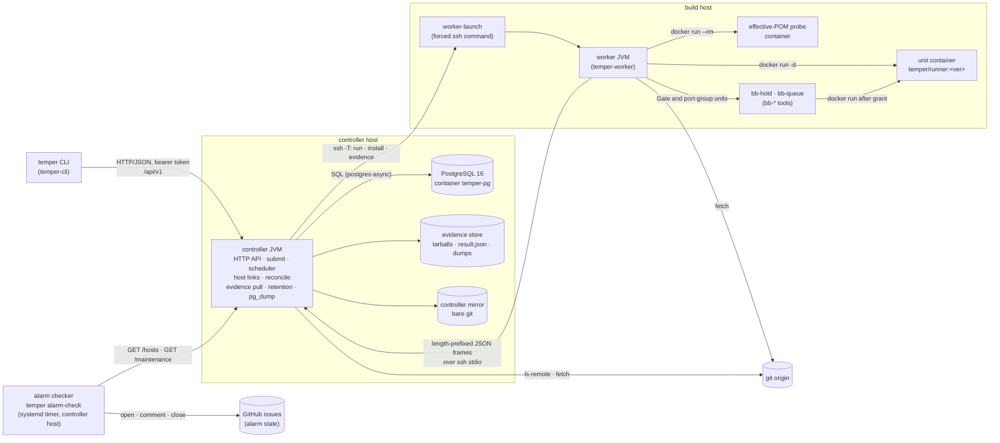
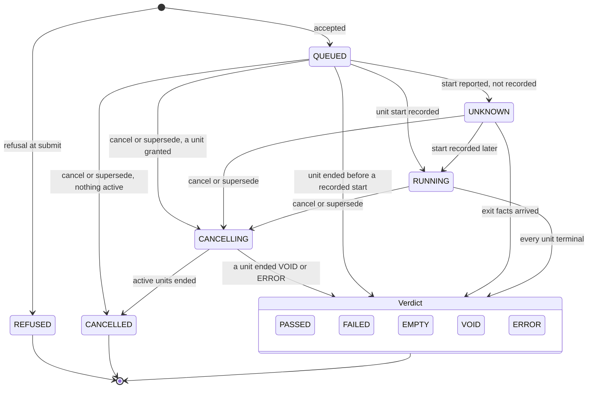

# temper architecture

This describes temper as the code on the M1 line implements it. The contract is `docs/spec.md`; the M1 design and its
rulings are `docs/m1-design.md`. Where this file and the code disagree, the code wins. Paths are abbreviated:
`domain/…` means `temper-domain/src/main/java/org/pragmatica/temper/domain/…`, and likewise for the other modules.

## 1. Components



| Component | Module | What it does |
|---|---|---|
| CLI | `temper-cli` | Parses a command line, sends HTTP requests (one or two per command; `wait` polls, `watch` long-polls), prints its line, exits with a stable code (`docs/user-guide.md`) |
| Controller | `temper-controller` | Serves `/api/v1`, resolves sources, plans and refuses, schedules units onto hosts, keeps one ssh link per host, reconciles after every handshake, pulls evidence, runs retention and the daily `pg_dump` |
| Store | `temper-store` | PostgreSQL schema (`V1`…`V4` migrations, applied at controller start) and the store port (`store/api`) the controller's use cases call |
| Protocol | `temper-protocol` | The frame codec, the controller⇄worker messages (`protocol/message/Message.java`), the HTTP DTOs (`protocol/api`), the shared JSON mapper, the process runner and the surefire XML parser |
| Domain | `temper-domain` | Pure rules: value objects, the planner, refusals, verdicts, manifest rules, hold rules, the retention plan, exit codes |
| Worker | `temper-worker` | One process per (controller, host) link: prepares workspaces, builds the runner image, starts and watches unit containers, enforces timeouts, collects reports and the manifest, answers reconcile scans |
| Runner image | `temper-worker` resources | `temper/runner:<ver>`, built by the worker on first use from `runner/Dockerfile` (temurin 25 pinned by digest, Maven 3.9.12 checked by sha512, `git`, `python3`) and the `RunSteps` launcher |
| Dist | `temper-dist` | Collects the deployable jars of one build in `target/dist` |
| Alarm checker | `temper-cli` (`cli/alarm`, `cli/command/AlarmCommand.java`) | `temper alarm-check`, outside the controller: run every 10 minutes by `ops/temper-alarm.timer` on the controller host, it reads `GET /hosts` and `GET /maintenance` and the local disk, and delivers each condition to a GitHub issue. It is stateless: the open issues and their comments are its only state (`docs/user-guide.md` §3.8) |

### 1.1 How they talk

- **CLI → controller.** HTTP/JSON under `/api/v1`. Every route requires the bearer token (`controller/http/Router.java`);
  without it the answer is 401. An optional read token (`[server] readTokenFile`, `controller/http/Credentials.java`)
  passes the READ routes (the GETs except `subscribers/{name}/next`, `Route.Scope`) and gets 403 on the rest. The routes are listed in `controller/api/ApiRoutes.java`; `GET /maintenance` answers the latest `pg_dump` run and
  when the latest good one ended (`MaintenanceView`), for the alarm checker. `GET /digest` (`controller/api/DigestRoutes.java`,
  use case `controller/digest/Digest.java`) answers what changed after a caller-held cursor on `events.seq` and what stands
  now, as JSON or text for agents (`temper digest`, `docs/user-guide.md` §3.9); it writes nothing, reading in one
  `REPEATABLE READ, READ ONLY` transaction (`store/pg/PgDigestStore.java`). Its "why not running" (D1) is
  `controller/policy/GrantExplain.java`: host by host in configured order it replays one grant round of
  `GrantPolicy.choose` on a snapshot built as `Scheduler.snapshot` builds it, over the grant's candidates read in that
  transaction less what earlier hosts would grant, and gives each unit the round
  would not grant its cap, `Fit` or starvation-hold reason (`Fit` is the fit rule both read). The facts, active units
  and starvation state come from outside the transaction, so it is what the policy would decide now, not what the last
  tick did. Events are delivered by
  long-poll (`GET /subscribers/{name}/next`, `POST /subscribers/{name}/ack`), the m0-design §6.5 fallback, instead of
  the spec's WebSocket route; the code's stated reason is that rc4's WebSocket did not reach its handler
  (`controller/events/EventFeed.java`, class comment).
- **Controller → worker.** The controller runs `ssh -T <user>@<address> run <ver>` with a restricted key whose forced
  command is `ops/worker-launch`. The launcher allows exactly three verbs: `run <ver>` (start the installed worker jar
  after checking its sha256), `install <ver> <sha256>` (receive a jar on stdin) and `evidence <job> <unit> small|full`
  (stream a tarball of a unit directory, read-only). The worker's stdin and stdout are the frame stream: a 4-byte
  big-endian length, then that many bytes of UTF-8 JSON, at most 16 MiB (`protocol/frame/FrameCodec.java`).
- **Handshake.** The worker's first frame is `Hello`. The controller answers `Welcome` only if the protocol version is
  2 (`protocol/message/Handshake.java`) and the worker version equals the controller's own build version; otherwise
  `Incompatible`, and the next connect deploys the matching jar through `install`. The controller and worker therefore
  deploy together.
- **Worker → docker.** Units run as `docker run -d --name temper-<job>-<unit>` with the labels `temper.job`,
  `temper.unit`, `temper.version` (and the controller's `temper.instance`), the host user's uid and gid, the docker
  socket, the workspace bind-mounted at the same path, an allow-listed environment and a memory limit
  (`worker/unit/DockerRunArgs.java`). There is no shell anywhere on that path: steps are argv arrays that `RunSteps`
  executes in the container.

## 2. Job lifecycle

A **job** is what was submitted: a source, a recipe and options. A **unit** is one container execution of a job. In M1
every recipe plans exactly one unit (`domain/plan/Planner.java`):

| Recipe | Unit name | Kind (default timeout) | Steps | Manifest |
|---|---|---|---|---|
| `gate` | `gate` | `GATE_UNSHARDED` (3 h) | `mvn -B clean install` | yes |
| `moduleTest` | `main` | `MODULE_TEST` (60 min) | `mvn -B -pl <pl> -am install -DskipTests`, then `mvn -B -pl <pl> test [-Dtest=…]` (or `verify -Dit.test=…`) | yes, from the second step |
| `mvn` | `main` | `MVN` (60 min) | `mvn -B <args>` | no |

Every step ends with the forced `-Dmaven.repo.local=${ws}/.m2-local`. `mutate` parses but is refused as
`REFUSED(unsupported)`.

### 2.1 Job states

From `domain/state/JobState.java`:

| State | Terminal | Meaning |
|---|---|---|
| `REFUSED` | yes | A refusal at submit; persisted with its code and detail, no units |
| `QUEUED` | no | Accepted; no unit start recorded yet |
| `UNKNOWN` | no | A unit runs but its start could not be recorded (ruling R-13, amended) |
| `RUNNING` | no | A unit start was recorded |
| `CANCELLING` | no | A cancel (or a supersede) is waiting for active units to be killed |
| `SUPERSEDED` | no | Defined in the enum and the schema; no code path on this branch writes it (see §2.3) |
| `PASSED`, `FAILED`, `EMPTY`, `VOID`, `ERROR`, `CANCELLED` | yes | The verdict (§4) |



"Unit ended before a recorded start" covers a start that failed (`UnitStartFailed`: `VOID(disk)` from R-DISK at
unit start, an `ERROR` from workspace, image, effective-POM or bb-hold failures). The job is decided when every unit is
terminal (`store/api/UnitStore.java`, `complete`).

### 2.2 Unit states

From `domain/state/UnitState.java`: `QUEUED → GRANTED → RUNNING | UNKNOWN → PASSED | FAILED | EMPTY | VOID | ERROR |
CANCELLED`, with `CANCELLING` on the cancel path.

- **GRANTED** is set by the scheduler's grant. A unit that waits in bb-hold stays GRANTED with `port_group = 'waiting'`;
  once bb-hold grants the ticket it becomes RUNNING with `port_group = 'held'` and the ticket recorded
  (`store/api/UnitStore.java`, `holding` and `started`).
- **GRANTED → QUEUED** (requeue) happens in reconcile, for a unit that never ran (no marker on disk, or a bb-hold
  holder that died before its grant), and **any active unit → QUEUED** when its host is LOST (§2.4, rule L4), at most
  once per unit.
- **Attempts** (M4): every grant increments the unit's `attempt` (`units.attempt`, 0 before the first grant), the
  worker stamps it on the unit directory and the container label, and every unit frame carries it. A start, lease,
  hold or completion is applied only for the current attempt on the reporting host (`PgUnitStore`: `host = $h AND
  attempt = $a`); anything from an older attempt is answered and stored as nothing. A lost attempt is a
  `unit_attempts` row and a `unit-lost` event, shown in the unit's `lostAttempts` (`GET /jobs/{id}`, the result
  record).
- **UNKNOWN**: the worker reported the start but the store write failed or has been in flight for more than 1 s
  (`controller/host/LinkTiming.java`, `unrecordedAfter`). The job then reads UNKNOWN, never QUEUED.

### 2.3 Supersede

A job submitted by ref supersedes the earlier `QUEUED`, `UNKNOWN` or `RUNNING` jobs with the same ref and **the same
recipe**, parameters included (`jobs.recipe_canonical`, `Recipe.canonical()`), at a different SHA
(`store/pg/PgJobStore.java`, `VICTIMS`); priority, `keep` and the unit-timeout override are not part of the match. A job
with nothing active is cancelled at once; one with active units goes to `CANCELLING` and its units are killed; a `keep`
job with active units runs on and is only marked superseded. The terminal record carries the `superseded` annotation.
Jobs submitted by SHA are never superseded.

### 2.4 Host states: UP, down, LOST, deferred (M4)

A configured host has its link's state (`controller/host/LinkState.java`: DOWN, CONNECTING, HANDSHAKING, UP, STOPPED)
and, separately, a **LOST** flag with its mark (when, and why: `link-down` or `host-key`), held by `HostLink` and
stored in `hosts.state = 'LOST'`, `lost_at`, `lost_reason`. The link keeps reconnecting while the host is LOST.
`GET /hosts` shows `state: LOST`, the link's own state in `link`, and the mark in `lost`
(`protocol/api/HostView.java`). The decision is pure (`controller/host/HostLiveness.java`), run on every liveness
tick (5 s), on a host-key failure and when the link leaves UP:

| Verdict | When | What the scheduler does |
|---|---|---|
| healthy | the link is UP and its down clock is clear | grants |
| down | the link is not UP, for less than `hostLostSeconds` (`[scheduler]`, default 600) | skips the host (`no-link`); its units keep their state, as before M4 |
| **deferred** | the link is UP again, but its UP has lasted less than `stableUp` (60 s) and the clock passed `hostLostSeconds` (ruling Q-M4-12) | skips the host (`no-link link=DEFERRED`); if the UP lasts `stableUp` the clock clears and nothing is requeued; if the link leaves UP first, the host is LOST at once |
| **LOST** | the clock reached `hostLostSeconds`, or an ssh session failed host-key verification (at once) | skips the host (`lost <reason> since=<instant>`) and settles its units |

The down clock starts when the link leaves UP and at controller start; it resets only after `stableUp` of UP, so a
flapping link is still down. A host stored LOST stays LOST across a controller restart: the link reads the mark
before it connects or writes anything.

**Settling a LOST host's units** (`store/pg/LostSettlement.java`, pure rule `domain/state/LostSettle.java`), each
unit in its own transaction, under the job and unit locks, only while the unit is still active on that host in the
listed attempt and the host is still LOST. First matching rule:

| # | Unit | Outcome |
|---|---|---|
| L1 | CANCELLING | CANCELLED (`killedBy = cancel`); no lost-attempt row |
| L2 | `side_effects = external` | `ERROR(host-lost)`, never requeued (R-M4-5) |
| L3 | already requeued once (`host_lost_requeues = 1`) | `ERROR(host-lost)` |
| L4 | otherwise | the attempt ends `ERROR(host-lost)` in `unit_attempts`; the unit is QUEUED again, `host_lost_requeues = 1` |

The settle runs again on every liveness tick while the host is LOST (level, not edge), so a settle that failed half
way completes later; every rule is a conditional update, so a repeat changes nothing. A RUNNING job whose unit is
requeued stays RUNNING. The requeued unit may run on any eligible host, the one it was lost on included once that
host recovers.

**Recovery** is automatic, on the next handshake that completes (ruling Q-M4-3), in this order: ssh connects against
the configured `knownHosts`; `Hello`/`Welcome`; the settle runs to completion; reconcile discards superseded attempts
on the host (rule 0: kill the container, delete the directory, never collect its result) before anything else; then
`hosts.state = 'UP'` with the mark cleared (`HostStore.recovered`), and only after that write commits does the flag
clear and the host take grants. An operator who does not want the host back removes its `[[hosts]]` entry or sets
`retireAt` in the past and restarts the controller.

End to end (`temper-acceptance`, `-Pacceptance`, m4-design §12.3): `MultiHostLostIT` takes one of two real worker
hosts dark mid-unit and shows LOST after `hostLostSeconds`, the unit requeued once and passed on the other host as
attempt 2 with one stored result, the superseded attempt discarded on return, then UP; `SideEffectNotRequeuedIT` shows
an `external` unit on the lost host ending `ERROR(host-lost)` without a requeue.

**Retired** (`[[hosts]] retireAt`): from that instant the scheduler grants nothing new on the host (`retired since=
<instant>` in the digest; `retired: true` in `GET /hosts`); running units finish. **Shared CPU** (`[[hosts]]
sharedCpu`): a `--dedicated-cpu` job's unit is never granted there. Both are described with the cloud hosts in
the cloudbb host record.

### 2.5 Refusals at submit

A refusal persists the job as `REFUSED(<code>)` with its detail and answers 422 (`domain/refusal/RefusalCode.java`).
The structural checks run in this order (`domain/refusal/Refusals.java`, `checkSubmit`; the first failure is the
refusal), then the data-driven rules in row order:

| Code | Refuses |
|---|---|
| `R-ENV` | a request `env` field: the container environment is a fixed allow-list |
| `R-M2` | a user `maven.repo.local` or a settings file (`-s`, `-gs`, `--settings`, `--global-settings`) |
| `R-SHELL` | an argv that does not run `mvn`, a shell-capable plugin goal (`exec:exec`, `exec:java`, `antrun:run`, long forms) or `exec.executable` |
| `R-EFFECT` | a phase, plugin goal or `-P` profile off the build-only allowlist (deploy, release, a push), a user `-D` property off its allowlist, an unlisted option spelling, `-fn`/`--fail-never`, or a value with control, whitespace or format characters (`domain/mvn/SideEffectRule.java`, `SideEffectAllowlist.java`; rulings R-M4-14, Q-M4-11, Q-M4-11b–d). After `R-SHELL`, so a shell goal is `R-SHELL`. It judges argv only; the containment is structural (no publishing credentials on build hosts) |
| `R-1553`, `R-FAILSAFE` | the seeded `refusals` rows: an excluded test class, a missing `-Dit.test` (judged with the tree's reactor) |

Refused before those checks: `source` (the SHA or ref cannot be resolved), `fork-pr` and `pr-origin-unverified`
(spec §13, R-M2-7), `unsupported` (a recipe temper does not run: `mutate`), `rerun` (a rerun's preconditions,
m2-design §5.1). `R-DISK` is not a submit refusal: the worker applies it at unit start, and the unit ends `VOID(disk)`.
`port-group` is kept only for historic rows (m1-design §1.6).

## 3. Scheduling and priority

The scheduler (`controller/scheduler/Scheduler.java`) ticks every `[scheduler] intervalSeconds` (default 2 s) and on
every wake signal (raised by a submit, a cancel, a unit completion and a link coming UP, among others). Requests during
a tick coalesce into one more tick; a tick is time-bounded, and a host whose grant round is still in flight is skipped
by later ticks, so one host never has two grant rounds at once. For each UP host with facts it opens
one store transaction that locks the QUEUED units with `SELECT … FOR UPDATE OF u SKIP LOCKED`, ordered by priority
descending, submit time ascending, unit id ascending (at most 200), and grants with a conditional
`UPDATE … WHERE state = 'QUEUED'` (`store/pg/PgUnitStore.java`).

The grant policy (`controller/policy/GrantPolicy.java`), per host, in order:

1. **Cap:** host reactors = foreign Maven launchers (from the worker's `/proc` scan, excluding processes inside temper
   containers) + temper's active units (GRANTED, UNKNOWN, RUNNING, CANCELLING). At or above `cap` (default 5), nothing
   is granted.
2. **Fit:** active memory + the unit's memory ≤ `memoryBudgetMb`; when the host sets `[[hosts]] memFloorGiB` (default
   0, off; a whole number up to 1024), the worker's MemAvailable − the memory of temper's units it does not reflect yet
   − the unit's memory ≥ the floor (a unit counts as not reflected until a heartbeat sampled after its recorded start
   arrives, so a GRANTED unit and one granted earlier in the round always count; `controller/policy/HostSnapshot.java`;
   memory a just-started JVM has not touched yet is not seen, so the floor is a margin, not a reservation); free disk (the smaller of the docker root and the
   workspace filesystem) ≥ the floor (`[units] diskFloorGiB`, default 50); and, for a unit that goes through bb-hold,
   fewer than `[portGroup] maxHolding` (default 1) temper units waiting for or holding the port group on that host.
3. **Head:** if the first unit in order (the head) fits, it is granted.
4. **Starvation:** a head that does not fit starts a clock; once it has been blocked longer than
   `[scheduler] starvationSeconds` (default 1200), the host grants nothing until the head fits. The clock lives in
   memory and resets on a controller restart.
5. **Backfill:** otherwise the first later unit that fits is granted.

**Priority** is an integer in −1000..1000; higher runs first; the default is −20 (`domain/model/Priority.java`).
Priority, `keep` and the owner are not part of the dedup key. For a bb-hold unit, the job priority is also passed to
bb-hold as its advisory `<prio>`.

**Memory:** a Gate unit gets `[units] gateMemoryMb` (default 16384), every other unit `[units] memoryMb` (default
6144), as the container's `--memory` (`controller/config/ConfigLoader.java`).

**Leases:** a granted unit's lease (`[scheduler] leaseSeconds`, default 30) is refreshed by the worker's 10 s
heartbeat, for the attempt the heartbeat names (`PgUnitStore.LEASES` keys each unit as `job/unit/attempt`). An expired
lease is only shown (`UnitView.leaseExpired`); it never re-grants the unit. What re-grants a unit is its host being
declared LOST (§2.4): a host that stays connected, or returns within `hostLostSeconds`, keeps its units, which then
run at most once; a unit on a LOST host is requeued at most once, so its steps run at most twice and its result is
stored at most once; a unit with external side effects is never requeued and ends `ERROR(host-lost)`.

**Host limits and classes (M4):** the scheduler skips a host whose `retireAt` has passed (before any other check),
then a LOST host, then one not UP (or deferred), with a round in flight, or without facts. On a `sharedCpu` host the
candidate read leaves out `--dedicated-cpu` units (`PgUnitStore.CANDIDATES`), so they are never its head. The digest
explains a queued unit per host in that order (`retired`, `lost`, `no-link`, `busy`, …, `shared-cpu`).

## 4. How a result is judged

### 4.1 Testcases

At unit exit the worker walks the workspace for `**/target/{surefire,failsafe}-reports/TEST-*.xml` and keeps only the
files whose mtime is newer than the epoch written as **text** in `.temper/marker` before the container started
(`worker/unit/ReportCollector.java`); the marker file's own mtime is never read, so a copied marker cannot widen the
window. Each `<testcase>` element becomes one row `(class, name, outcome, time, unit)`, with outcome `passed`,
`failed`, `error` or `skipped`. The sum of the files' `tests=` attributes is kept as `testsAttr`, for comparison only.

### 4.2 Manifest, missing and drift

For `gate` and `moduleTest` units, before the build, the worker runs `help:effective-pom` in an auxiliary container
(`temper-<job>-<unit>-pom`, `worker/manifest/PomProbe.java`) with the main step's reactor selection. At exit it reads
the effective POM and the compiled test classes (`java.lang.classfile`) and computes the manifest
(`domain/manifest/ManifestRules.java`): the classes the reached surefire and failsafe executions are expected to report,
by each module's own includes, excludes, groups, skips and `-Dtest`/`-Dit.test`. `@Nested` classes are entries named
`Outer$Inner`, or by their own `@DisplayName` where the plugin version reports it so (`domain/manifest/ReportNaming.java`).

The manifest has two sets: **required** and **optional** (ruling R-2). With `reported` = the `classname` values of the
rows:

- `missing` = required − reported → `FAILED(missing-classes)`; this is how a crashed fork is caught.
- `drift` = reported − (required ∪ optional) → the annotation `manifest-drift=<n>`; it never changes the verdict.
- `notReached` lists modules with test sources but no compiled test classes (the reactor stopped before them).

A configuration the rules do not model (`includesFile`, tag expressions, JUnit 3/4 classes, an unmeasured plugin
version, a shared or blank `@DisplayName`, …; `domain/manifest/ManifestError.java`) makes the unit
`ERROR(manifest: <reason>)`. A failed effective-POM step stops the unit before the build. The engine models JUnit 5
(Jupiter) only (ruling R-11).

### 4.3 Verdict

`domain/verdict/Verdicts.java` evaluates in this order; the first match wins:

| Order | Verdict | Condition |
|---|---|---|
| 1 | `VOID(reason)` | A unit has a void reason: `disk` (R-DISK at start, or the run floor during the run) or `port-group-lost` |
| 2 | `ERROR(reason)` | A unit has an error reason (`lost`, `report`, `marker`, `manifest: …`, `seed-isolation`, `port-group: …`, `infra: …`), or `ERROR(plan)` when one class is reported by more than one unit |
| 3 | `CANCELLED` | A cancel was requested (by a user or by supersede) |
| 4 | `FAILED(timeout)` | A unit was killed by its timeout |
| 5 | `EMPTY` | A unit that requested tests exited rc 0 with 0 testcases; the reason lists those units |
| 6 | `FAILED(missing-classes)`, then `FAILED(tests)`, then `FAILED(rc)` | Missing classes; a failed or error testcase; a non-zero or unknown rc |
| 7 | `PASSED` | Everything else |

A unit with rc ≠ 0 and 0 testcases is `FAILED(rc)`, not EMPTY. A VOID or ERROR record still lists every observed failed
or error testcase (`observedFailures`). Annotations never change the verdict: `superseded`, `manifest-drift=<n>`,
`evidence=missing`.

## 5. Evidence and retention

### 5.1 Evidence

When a unit's last report chunk arrives (`controller/host/WorkerEvents.java`):

1. the controller pulls the **small** tarball over a second ssh session (`worker-launch evidence <job> <unit> small`:
   `.temper/`, `reports/`, `threaddumps/`, `manifest/`, `log.tail`);
2. one store transaction completes the unit (testcases, manifest, evidence row, end facts) and, if it was the last
   unit, writes the result row;
3. `result.json` is written when the job finished;
4. the worker gets `UnitReportAck`;
5. the **full** tarball (the whole unit directory, full log included) is pulled in the background, unless the evidence
   filesystem has less than `[evidence] minFreeGiB` (default 20) free.

A tarball is written to a `.partial` sibling, checked (rc 0, gzip magic, size cap: `maxSmallMiB` 256, `maxFullMiB`
1024), forced and renamed (`controller/evidence/SshEvidence.java`, `Tarballs.java`). Layout under `[evidence] root` (default
`~/.local/share/temper/evidence`, `controller/evidence/EvidenceLayout.java`):

```
jobs/<job>/result.json
jobs/<job>/units/<unit>/a<n>/evidence.tar.gz small, of attempt n (m4-design §4.6)
jobs/<job>/units/<unit>/a<n>/full.tar.gz     full, of attempt n
pgdump/temper-<yyyymmddThhmmssZ>.dump
```

Units ended as lost, or whose bb-hold failed, are not pulled (ruling R-8): their files stay on the host until retention.

### 5.2 Retention

`controller/retention/RetentionGc.java` runs every `[retention] intervalMinutes` (default 60) with the plan of
`domain/retention/RetentionPlan.java`, clocks from the job's finish (`RetentionPolicy.DEFAULT`):

| What | Kept for |
|---|---|
| full tarball | 14 days |
| small tarball, `testcases`, `manifests`, `unit_facts` rows | 90 days |
| host checkout (`~/.temper/jobs/<job>` on the worker host) | 24 hours |
| events (by event time, `keep` or not) | 30 days |
| `pg_dump` files | 14 days; the newest verified dump is always kept |
| `results`, `jobs`, `units`, `result.json` | never deleted |

Jobs with `keep`, and jobs not yet terminal, are never planned for deletion, except their events, which age out by
event time like every other event. Host checkouts are deleted by the worker
(`GcJobs`), only when no unit of the job is active, no container carries the job's label, and every unit directory has
an rc or no marker; a tree it cannot fully delete is kept and reported.

## 6. Source resolution

`controller/submit/SourceResolver.java` and `controller/git/GitCli.java`:

- **By ref:** `git ls-remote --exit-code -- <origin>` with the patterns `refs/heads/R`, `refs/tags/R`, the peeled
  `refs/tags/R^{}` and `R` (`controller/git/LsRemote.java`), filtered to exact names (an annotated tag resolves to its
  commit). Exactly one distinct commit must remain; none or several is `REFUSED(source)`. The
  resolved SHA is stored, so a later push to the ref does not change the job.
- **By SHA:** only full 40-hex SHAs are accepted. The controller fetches its bare mirror (`[repo] mirror`, cloned with
  `--mirror` on first use, then `fetch --prune` of `refs/heads/*`, `refs/tags/*` and `refs/pull/*/head`). It requires
  that some **branch head or pull-request head** contains the commit:
  `git for-each-ref --contains <sha> refs/heads`, then, only if none does, every `'refs/pull/*/head'` (maintainer M1-3,
  R-M2-7). Candidates are ordered oldest first, by PR number as an integer.
  - Fork PRs are usually newer; an older fork can be force-pushed. So neither a fork answer nor a per-PR failure
    stops the walk.
  - `controller/submit/PullJudgement.java` judges the candidates. Origins already known cost nothing. The rest are
    asked in order. The walk ends at the first same-repo PR, which accepts, or at the first API-wide failure.
    - Per-PR failures go on: 404, 410, 422, an unreadable, incomplete or declared-oversized answer.
    - API-wide failures stop: 403/429, a 5xx, no answer, a non-github origin.
  - Each PR is asked through `controller/git/GitHubPulls.java`: unauthenticated
    `GET https://api.github.com/repos/{owner}/{repo}/pulls/{N}`, with owner and repo taken from `[repo] origin`.
    Accepted origin URLs: `git@`, `ssh://` (optional `:22`) and `https://` (optional `:443`), with a case-insensitive
    `github.com` host. A PR is same-repo iff `head.repo.full_name == base.repo.full_name`.
  - The judged origin is cached per controller process, so a restart costs the API calls again. Failures are not
    cached.
  - Rate-limit exhaustion refuses with `pr-origin-unverified`. It recovers once the budget resets, and the progress
    kept in the cache carries over.
  - Every candidate a fork (a deleted fork included) → `REFUSED(fork-pr)`.
  - `REFUSED(pr-origin-unverified)` covers a non-github origin, an API failure, the 10 s deadline on the whole
    exchange (body included), a body over 1 MiB, a non-200 answer and an unreadable body, plus candidates the walk
    did not reach. Any recorded failure gives this refusal, even when every answered PR was a fork. It fails closed and can be retried by resubmitting.
  - No ref → `REFUSED(source)`.
  A ref given in full outside `refs/heads`/`refs/tags` (`refs/pull/7/head`) must pass the same check after `ls-remote`.
  `refs/pull/*/merge` is never fetched. The first `--mirror` clone brings it anyway, and no later fetch refreshes it,
  so it is outside the pattern. The worker's mirror fetches its configured `+refs/*:refs/*`, so it holds PR heads
  too.
- `bundle` and `patch` sources parse but are refused as `REFUSED(unsupported)`.
- A git failure (origin or mirror unreachable) is HTTP 503 and persists nothing.

The worker keeps its own bare mirror (`~/.temper/mirror.git`), fetching only when the commit is absent, and checks the
SHA out detached in `~/.temper/jobs/<job>/ws` (`worker/workspace/WorkspacePreparer.java`). The workspace's `.m2-local`
is a copy of the host seed `~/.temper/seed-m2` (`worker/workspace/Seeder.java`), and before any unit runs the worker
checks that no file in it has a link count above 1 and that it holds no symbolic link (`SeedVerifier.java`); a failure
is `ERROR(seed-isolation)`.

## 7. Host coordination

temper shares build hosts with the bb-* tools. What the code does:

- **Cap counting.** The worker reads `/proc` for Maven launchers whose cgroup is not inside a temper container
  (`domain/facts/HostReactors.java`, `worker/facts/FactsProbe.java`). Temper's own units are counted from the store,
  never from `ps`, so nothing is counted twice.
- **bb-* ticket facts.** The worker reads `~/tools/bb-queue 0` for the running and waiting bb-* tickets and records them
  in the unit's facts. It never writes bb-* state itself.
- **Port group.** The planner marks a unit `needsPortGroup` when a step that runs tests may include a module listed in
  `[portGroup] modules` (`domain/plan/PortGroupRule.java`, with the reactor read from the tree at submit; an empty list
  disables the rule). Such a unit goes through bb-hold when it is a Gate or the host is not `portIsolated`
  (`controller/policy/HostSnapshot.java`). The worker spawns
  `setsid ~/tools/bb-hold <owner> <prio> --container temper-<job>-<unit> -- docker run …` detached
  (`worker/unit/BbHoldLauncher.java`), watches `bbhold.err` for `granted <ticket>`, and only then counts the unit as
  started; its timeout counts from the grant. bb-hold owns `docker wait` and releases the ticket when the container
  exits.
- **Holder loss.** On every heartbeat the worker checks each held unit's holder (pid plus `/proc` start time, so a
  recycled pid does not pass) twice, 2 s apart, each read before the container state (`domain/hold/HoldRules.java`).
  Two dead observations while the container runs → `VOID(port-group-lost)`, the container is killed, and the worker
  runs `~/tools/bb-queue reap` to release the dead holder's ticket; an older bb-queue without `reap` is logged and
  tolerated (the deploy runbook).
- **Networks.** A non-Gate unit runs in its own bridge network `temper-<job>-<unit>`, with
  `TESTCONTAINERS_HOST_OVERRIDE` set to its gateway. A Gate unit runs with `--network host` and the override
  `localhost` (maintainer ruling 2026-10-14, `worker/unit/UnitNetwork.java`). No unit publishes a fixed host port.
- **One worker per host.** `~/.temper/worker.lock` is held by the running worker; a second waits up to 30 s, then exits
  75 and the controller retries.

The bb-hold contract and its exit codes are recorded in the host record the bigboy host record (bigboy
is the M1 build host and the CLI's default controller host).

## 8. Failure handling

| Failure | What happens |
|---|---|
| ssh drop or worker exit | Unit containers (and bb-hold) keep running: they are detached. The controller reconnects with backoff 1 s doubling to 60 s with jitter, and reconciles |
| host down for `hostLostSeconds`, or a host-key failure | The host is LOST (§2.4): its active units are settled (cancelled, requeued once, or `ERROR(host-lost)`); recovery settles, discards superseded attempts, then marks it UP |
| controller restart | Every host is reconciled as on a reconnect; a host stored LOST stays LOST |
| reconcile (`controller/policy/Reconciler.java`) | rc on disk or container exited → collect; container running → re-attach (timer re-armed with the stored timeout); holder waiting or holding → re-attach; marker but no container and no rc → `ERROR(lost)`; holder dead before its grant (no `granted` line) with no container → the container never started: requeue, or cancelled when CANCELLING; holder dead after its grant with no container → `ERROR(lost)`; no marker and no recorded start (no `startedAt`, not UNKNOWN) → requeue, or cancelled when CANCELLING; no marker but a recorded start → `ERROR(lost)`; a running temper container the store does not know → killed. Containers labelled for another controller instance are left alone |
| unit timeout | The worker writes `killed=timeout`, takes `jcmd <pid> Thread.print` of every JVM in the container into `threaddumps/`, then `docker kill`: `FAILED(timeout)` |
| cancel | Container killed before its driver; for a waiting hold, bb-hold is sent SIGTERM and the container re-checked by name |
| disk below the run floor (10 GiB) during a run | `.temper/void = disk`, the unit keeps running, the verdict is `VOID(disk)` with observed reds listed |
| start write fails | Retried after 200 ms, 1 s, 2 s and 5 s, each attempt bounded by 5 s; then dropped and the unit shown UNKNOWN until its exit facts arrive (ruling R-13) |
| report cannot be stored | The session is reset; the reconcile on reconnect collects the unit again; nothing was acked |
| evidence pull fails | Retried once after 30 s, except when `worker-launch` refused it, the unit directory is missing or the size cap was exceeded; the record says `stored: false` and carries `evidence=missing`; the verdict is unchanged |
| git down at submit | HTTP 503; nothing persisted |

## 9. Guarantees, each with its mechanism

None of these promises that a unit runs once and only once. A unit on a host that stays connected, or returns within
`hostLostSeconds`, runs at most once; a unit on a LOST host runs at most twice (one requeue), and its result is stored
at most once (spec §6.4, §13).

| Operation | Guarantee | Mechanism | Where it stops holding |
|---|---|---|---|
| submit | When the submit returns 200, the job and its units are committed with the resolved SHA; a refusal returns 422 with a persisted REFUSED job | the source is resolved inside the call; one transaction inserts the job, its units and its `queued` event | git failure: 503, nothing persisted |
| dedup | Two submits with the same key, neither `--fresh`, against one database get one job while the first is in a reusable state (QUEUED, UNKNOWN, RUNNING, PASSED, FAILED, EMPTY) | `pg_advisory_xact_lock(7071, hashtext(dedup_key))` around the look-up and insert; key = sha256 of source identity, canonical recipe-with-options JSON and the controller's whole build version, judge included (`domain/dedup/DedupKey.java`, `ControllerConfig#dedupRunner`, D-6 A1) | VOID, ERROR, CANCELLED, REFUSED, CANCELLING jobs never deduplicate, by design |
| grant | At most one grant per unit per attempt, with one controller | `FOR UPDATE … SKIP LOCKED` plus `UPDATE … WHERE state = 'QUEUED'` in one transaction | A second controller on the same database is not supported (spec §13) |
| run | A unit whose host is not declared LOST is not re-run by temper: a re-attach finds it, or it ends `ERROR(lost)`. A unit on a LOST host runs at most twice; one with external side effects at most once | the marker is written before `docker run` (and before bb-hold is spawned); requeue only without a marker; the host lock rules out a stale worker's late start | A LOST host's unit is requeued by design (L4), and its first attempt may run on to its end if the host returns; nothing it does after the loss is stored, and its effects outside the workspace are not undone. Triple fault: the start write is dropped, the UNKNOWN mark never lands either (the unit is still GRANTED with no `started_at`), **and** the unit directory is lost; reconcile then sees no marker and requeues, so the unit can run twice (m1-design §14, R-13; `store/pg/PgUnitStore.java` `REQUEUE`) |
| stored result | At most one stored result per unit | the terminal transition is a conditional UPDATE under the unit row lock requiring `host = $reporting host AND attempt = $reported attempt` and an active state; testcases, manifest and evidence rows are written only in that transaction; `results`/`testcases` are write-once | — |
| timeout | A unit is killed after its bound, with thread dumps first | the worker's timer, re-armed from `.temper/start` on every re-attach | Deferred while no worker is attached; fires at once on the next re-attach. The kill can trail the deadline by up to 60 s per JVM dumped |
| port group | A bb-hold unit's container starts only after bb-* granted a `[port-group]` ticket, and the ticket is held until the container exits, through ssh drops and restarts | bb-hold runs in its own session and owns `docker wait` | Holder death while the container runs → `VOID(port-group-lost)`, detected on the first heartbeat after the death (two reads 2 s apart within one round, so within about 12 s) while a worker is attached |
| result record | No UPDATE or TRUNCATE of a `results` or `testcases` row succeeds; a DELETE succeeds only in a transaction that ran `SET LOCAL temper.retention = 'on'`; retention never deletes `results` rows | write-once triggers on `results` and `testcases` (`V1__m0_schema.sql`, `temper_write_once`) | The DELETE door is a guard against accidental deletes, not an authority boundary: any session with the database user can set that variable and delete. A database loss: see `result.json` and `pg_dump` |
| `result.json` | Every result row has a byte-identical `result.json` within one sweep interval of its commit | atomic write after the finishing commit; a sweep at start and every retention interval over jobs finished in the last 90 days | The evidence filesystem is not writable: logged and retried by each sweep |
| evidence | A record says `stored: true` only if every unit with a marker has its small tarball on the controller | the small pull runs before the completing transaction; fsync and atomic rename; sha256 recorded | Otherwise `stored: false` plus `evidence=missing`; a later pull does not change the record |
| events (`watch`) | Each matching event is printed at least once; a crash between print and ack repeats at most that one line, with its `seq`; events deleted by retention arrive as one `gap from=… to=…` line | events commit in seq order under an advisory lock; the cursor moves only on ack; the event floor and the events are read in one statement (`store/pg/PgEventStore.java`) | A new subscriber starts at the current end of the stream, not at the beginning |
| `pg_dump` | One TOC-checked dump per day the controller was up at or after `[pgDump] at` (default 03:30 local) | `pg_dump -Fc` in the `temper-pg` container (one snapshot), `pg_restore --list` fed the whole file (a broken pipe after the TOC is tolerated; its exit code and a non-empty TOC decide), then rename; a failed run's detail keeps the whole cause chain; a catch-up run at start when the newest good dump is older than 24 h | The check reads the archive's table of contents; it is not a restore |
| alarm delivery | Each check attempts every condition, concurrently and independently, after one read of the open issues; any failure, or the delivery exceeding its 120 s deadline, exits 2 once all were tried | the checker keeps no state: the open issues, identified by their body marker line, and the checker's own marker-ending comments are the state (`cli/alarm/GithubIssueSink.java`) | GitHub's open-issue list lags its writes, so two checks close together can both open an issue; the next lines name the duplicate for a person to close. A just-closed issue can still be listed open, so the alarm can go unnotified for at most one check interval. The deadline does not cancel: a write already sent can land after exit 2. Resolving the host name and measuring a hung mount run before any deadline. Nothing alerts when the controller host itself is down |
| retention | Nothing of a `keep` or non-terminal job is deleted except its events, which age out at 30 days like all events | the pure plan emits no job action for them; the event horizon is computed regardless of `keep` (`domain/retention/RetentionPlan.java`) | — |
