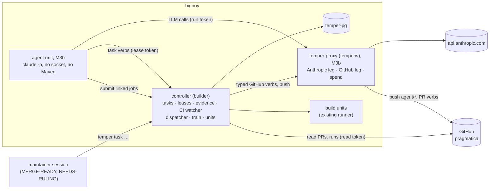

# temper — M3 design: the agent work pipeline (draft, revision 3)

**Status.** Revision 3: the maintainer reviewed revision 1 (`dcc82c3`) and approved the M3a direction; the rulings are
R-M3-9..R-M3-50 (§18), folded into the sections they change. Every question is ruled; M3a is in build (WP-1 first). The requirements are binding:
the M3 pipeline requirements (2026-10-20, owner-approved direction, with the
owner rulings of the same day). This document covers all of M3: the architecture end to end (§1–§3), a **build-ready
M3a** (§4–§11), M3b and M3c at design depth (§12, §13), safety and credentials across the phases (§14, §15), and the
open questions (§17). It says what M3 adds against the code on `main` (`02b9a41`) as read on 2026-10-20. It does not
restate the spec (`docs/spec.md` v0.2) or the M1/M2 designs (cited as m1 §n, m2 §n).

**Markers** (as in m0–m2): **[V]** verified by reading code or docs in this tree; **[U]** unverified, the coder or a
probe must confirm it first; **[P]** a temper proposal; **[G]** a guess forced by an underdetermined requirement.
**Q-M3-n** are questions for the maintainer or the owner (§17); the design proceeds on each marked guess until ruled.
**R-M3-n** are rulings; revision 1 carries in only the owner's and the team lead's rulings of 2026-10-20 (§18).

**Binding rulings carried in** (from M2, unchanged):
- **R-12** (owner): no backward compatibility until Aether GA; every schema change says what it does to existing rows.
- **R-10:** `store.api` names no protocol type.
- **R-4:** every new package is classified in `jbct.toml` in the commit that creates it.

**Naming.** In this document "M3" is the pipeline (R-M3-1). Spec §12 still names *sharded Gate + parallel Mutate* as
"M3"; R-M3-9 renames that row "M5 (sharded Gate, Mutate)".

---

## 0. Findings from the code and docs that drive this design

| # | Finding (file) | Consequence for M3 |
|---|---|---|
| F1 | The `builder` user is a docker-group member, and every unit container gets the docker socket and `--group-add <docker gid>` (spec §4.2; `worker/unit/DockerRunArgs.build`) [V]. Testcontainers' Ryuk runs in units (`TestcontainersReapTest`) [V] | Docker-group membership is root on the host. **Any `builder` process, and any test code a unit runs, can read any file and any process memory on bigboy**, `~temperw` included. Unix-user separation under `temperw` (R-M3-5) guards against accidental reads only (§14.1, Q-M3-1) |
| F2 | A unit lease (`units.lease_until`, refreshed by the 10 s heartbeat) is shown when expired and **never re-grants** (architecture §3, spec §6.4: at most once, visible loss) [V] | A task lease must re-queue on expiry (requirements "Model"), which the unit lease deliberately does not. The task lease is a new mechanism with a fencing epoch (§6); the unit lease is reused as the liveness signal of an M3b agent unit (§12.3) |
| F3 | `events.kind` has a CHECK list (V1, V4); `events` age out at 30 days (architecture §5.2) [V] | Metrics cannot be read from `events`. Task history goes into its own write-once log (§5.2); `events` gets a notification row so subscribers, `watch` and `digest` work unchanged (§9) |
| F4 | `Bundle`/`Patch` sources parse to `REFUSED(unsupported)`; the request body cap is 1 MiB (`Controller.MAX_CONTENT_LENGTH`) [V]; m2 §12 deferred both to M3 | A headless worker's inner-loop builds need an unpushed source (§12.4); mediated pushes need an upload route (§14.2). Neither is M3a work |
| F5 | `mutate` parses to `REFUSED(unsupported)` (architecture §2) [V] | "Mutants killed per changed production line" cannot be re-derived by temper until Mutate exists; it stays self-reported in M3a (§7.4, Q-M3-7) |
| F6 | The controller runs as `builder` under `systemd --user` with linger (`ops/temper-controller.service`, bigboy.md) [V]. Its ssh key, evidence root, mirror, config, token files and the `pg_dump` `docker exec` all live under or act as `builder` [V] | Moving the controller to `temperw` (R-M3-5) touches every one of these; §15.2 lays out the migration and the narrower alternative |
| F7 | One full token and one read token (`Route.Scope` = READ, WRITE) [V]. The full token can cancel jobs, add `known` entries and expire refusals (m2 §4.2: "attribution, not authority") | A worker holding the full token can do all of that. M3a adds a lease token that authorises only its own task's verbs at its own epoch (§6.4) and a worker token class for `claim` (Q-M3-21) |
| F8 | `GET /digest` and typed subscriber selectors exist (m2 §2, architecture §1.1) [V] | MERGE-READY and NEEDS-RULING reach the maintainer through the existing `watch`/`digest` paths with two new selector forms (§9.2); no new delivery mechanism |
| F9 | `ops/post-gate-status.py` already writes GitHub commit statuses through the operator's `gh` login [V] | A precedent of GitHub writes outside any proxy. The worker token's scope (Contents + Pull requests) cannot write statuses; this script stays an operator tool (§14.2) |
| F10 | bigboy cannot reach the private temper repo; pragmatica is fetched publicly (bigboy.md, deploy notes) [V] | The controller's GitHub reads for pragmatica need no secret; a zero-permission read token only lifts the rate limit (§10.4) |
| F11 | A job's workspace is a fresh checkout per job, seeded with a 316 MB copy of `~/.temper/seed-m2` (bigboy.md, `Seeder`) [V] | The per-build overhead an agent pays if its builds are temper units (§12.4) is a fetch, a checkout and that copy, plus `-am install`. Not measured yet [U] |
| F12 | `claude -p --output-format json` reports `total_cost_usd`, `num_turns`, `session_id` (Claude Code headless docs) [V]. `--max-budget-usd` exists and is checked between turns, so a run can exceed it (one external test reported a run exceeding a tiny cap) [U: single source] | The client's figure is a cross-check, never the meter, and `--max-budget-usd` is a soft inner bound (§14.3) |

---

## 1. Architecture end to end



- **Task** (§5): a durable record per unit of work, normally one PR. It holds the stage, round, lease, read point,
  head, the checklist history, rulings, linked evidence and linked temper jobs.
- **Stage queues** (§5.1): TRIAGED → (DESIGN) → CODE → VERIFY → {FIX → VERIFY} → CI → GATE → MERGE-READY, with
  NEEDS-RULING reachable from any stage.
- **Who works a stage:**

  | Stage | M3a | M3b | M3c |
  |---|---|---|---|
  | DESIGN, CODE, FIX | maintainer-spawned agent | headless agent unit (after VERIFY) | same |
  | VERIFY | maintainer-spawned agent | **headless agent unit, first** | same |
  | CI | **temper's CI watcher** (reads); a maintainer-spawned agent acts on its findings | watcher acts through the proxy | same |
  | GATE | maintainer or agent runs the combination gate; temper checks the evidence | same | **merge train** |
  | MERGE-READY, NEEDS-RULING | maintainer | maintainer (+ supervisor proposals, §12.6) | maintainer |

- **Builds and tests** always run as temper units (§12.4): an agent never runs Maven.
- **Evidence** (§7) is validated on the controller; every claim temper can re-derive from its own records is
  re-derived, and the rest is stored marked `self`.
- **Secrets** (§14, §15) never reach an agent: the proxy holds the Anthropic key and the GitHub token and exposes
  typed operations whose invariants hold whoever calls them.

## 2. Rollout

| Phase | Delivers | The maintainer's work |
|---|---|---|
| **M3a** (§4–§11) | task store, stages and transitions, leases with fencing, NEEDS-RULING, evidence schemas and re-derivation, the hygiene check, metrics, the CI watcher (read-only), CLI/API | spawns workers; they read and write the queue; the maintainer still runs GATE and merges |
| **M3b** (§12) | temper-proxy (Anthropic leg first), headless agent units for VERIFY, then CODE and FIX; Patch source; spend caps and kill switch; mediated pushes and PR verbs | works MERGE-READY, NEEDS-RULING and GATE |
| **M3c** (§13) | the merge train | works MERGE-READY and NEEDS-RULING only |

Each phase gets its own design → review → build → verify cycle; M3b and M3c get their own detailed design documents.
What is marked **deferred** below is designed only as far as M3a's schema and interfaces must leave room for it.

## 3. Trace table

| Requirement / ruling | Where |
|---|---|
| Model: task record (issues, brief, branch, base, head, read point, stage, round, checklist history, rulings, evidence, owner, timestamps) | §5.3, §5.4, §7.6 |
| Model: stages and NEEDS-RULING return | §5.1, §5.2 |
| Model: stateless single-step worker, crash loses one step | §6, §12.2 |
| Model: leases, timeout, "stuck past its lease twice", priorities | §6.2, §6.3, §8 |
| HR1 machine-checkable exit criteria + the four refusals | §7 |
| HR2 round cap → NEEDS-RULING with both reports | §5.2 (T9), §7.6 |
| HR3 NEEDS-RULING first-class, ruling text + SHA stored | §5.5 |
| HR4 merge train, bisect, GATED BATCH, stacked PRs, tree check | §13 |
| HR5 adversarial verifier, 1-in-K spot audit | §7.7, §12.2 |
| HR6 read-point discipline, fresh clone | §6.5, §7.3, §12.3 |
| HR7 deterministic dispatcher, LLM only for exceptions | §8, §12.6 |
| HR8 metrics from day one, ready-but-unpicked | §9 |
| HR9 spend cap and kill switch | §14.3 |
| HR9 write limits (no merge, tracker, `know:`, force-push, `archive/*`) | §14.2 |
| HR9 build rules (`~/.m2`, Maven only in bb-build) | §12.4 |
| HR9 public hygiene by a check | §7.5 |
| HR10 credentials: reach, scope, revocation, owner approval | §15 |
| Owner: a fixed budget, dedicated Console workspace backstop (R-M3-3) | §14.3, Q-M3-5 |
| Owner: credentials B, then C until the proxy exists (R-M3-4) | §15.1, Q-M3-4 |
| Owner: secrets under `temperw`; controller and proxy as `temperw` (R-M3-5) | §14.1, §15.2, Q-M3-1, Q-M3-2 |
| Owner: GitHub token scope and expiry (R-M3-6) | §14.2, §15.3 |
| Lesson (a): stacked base merged → no CI; watch the base, retarget or merge forward (R-M3-7) | §10.3 |
| Lesson (b): rerun keeps the run id; key on (run id, attempt) (R-M3-8) | §10.2 |
| Lesson (c): flag "base not release/main" and "no run for head" (R-M3-23) | §10.3 |
| Lesson (d): every worker clone pinned and stamped (R-M3-24) | §6.5 |
| maintainer rulings of revision 1's questions (R-M3-9..22, 25..30) | §18, folded into the sections cited there |
| Rollout M3a/M3b/M3c | §2 |

---

## 4. M3a scope and exit gate

**In M3a:** §5 task model and store, §6 leases, §7 evidence, §8 dispatcher order, §9 metrics and notifications,
§10 CI watcher, §11 API/CLI. Work packages and order: §11.4.

**Not in M3a:** headless workers, the proxy, spend enforcement, mediated pushes (M3b); the merge train (M3c). In M3a
the write limits of HR9 are **not** enforced by mechanism: maintainer-spawned workers use the credentials they use today. M3a
detects and refuses (head mismatch, delta class, hygiene, merged-outside-MERGE-READY alarm), it does not prevent. That
is stated here so nobody reads the M3a task API as a sandbox.

**Exit gate (M3a)** [P]:
1. Every probe in §11.5 goes red when its mutation is applied (independent verifier, never the author).
2. One real pragmatica task driven through CODE → VERIFY → FIX → VERIFY → CI → GATE → MERGE-READY → MERGED by
   maintainer-spawned workers, with every transition's evidence accepted by validation and stored.
3. Live refusals on that task's scratch twin: zero tests, head mismatch, missing read point, a `-Djbct.skip` job, a
   wrong delta class, a hygiene hit, a stale epoch. Each is refused with its code.
4. `temper task metrics` shows queue wait, run time and ready-but-unpicked for every stage the task visited, checked by
   hand against `task_events` (instrument validated first on a doctored log).

---

## 5. The task model (M3a)

### 5.1 Stages and statuses

A task is in exactly one **stage** and one **status**.

| Stage | Who acts | Terminal |
|---|---|---|
| `TRIAGED` | dispatcher (§5.2 T1) | no |
| `DESIGN` | worker | no |
| `CODE` | worker | no |
| `VERIFY` | worker | no |
| `FIX` | worker | no |
| `CI` | CI watcher (§10) | no |
| `GATE` | worker or maintainer (M3a), train (M3c) | no |
| `MERGE_READY` | maintainer | no |
| `NEEDS_RULING` | maintainer | no |
| `MERGED`, `ABANDONED` | maintainer | yes |

| Status | Meaning |
|---|---|
| `READY` | waiting for a worker to claim it |
| `LEASED` | a worker holds the lease at `lease_epoch` |
| `WAITING` | released by its worker while temper jobs or GitHub CI it named finish (§6.6); not claimable |
| `HELD` | in `MERGE_READY` or `NEEDS_RULING`, waiting for the maintainer |
| `CLOSED` | `MERGED` or `ABANDONED` |

`WAITING` exists because a stateless single step should not burn a lease (or, in M3b, tokens) polling a 1h41m Gate
(bigboy.md Gate 59). It also models the CI stage, which is always waiting on GitHub.

### 5.2 Transitions (domain, pure: `domain/task/TaskMachine.java` **+**)

`TaskMachine.apply(TaskState, Command, Instant now) → Result<Transition>`; a `Transition` is the new state plus the
events to append. Every row below is one test row (§11.5).

| # | From | Command (by) | Guard | To |
|---|---|---|---|---|
| T1 | TRIAGED/READY | `advance` (dispatcher) | every task in `after` has reached VERIFY or later [G, Q-M3-18] | DESIGN/READY if `design`, else CODE/READY |
| T2 | DESIGN, CODE, VERIFY, FIX or GATE /READY | `claim` (worker) | §6.1 | same stage/LEASED, epoch+1 |
| T3 | LEASED | `heartbeat` (lease) | epoch matches | same; `lease_until` extended |
| T4 | LEASED | `evidence` with `next` (lease) | §7 accepts; `next` allowed below | `next` in its entry status: READY for a worker stage, WAITING for CI, HELD for MERGE_READY |
| T5 | LEASED | `wait` (lease) | names ≥1 linked temper job or `ci` | same stage/WAITING |
| T6 | WAITING | `resume` (temper) | every awaited job terminal / CI decided | same stage/READY (same visit) |
| T7 | LEASED | `release(reason)` (lease) | — | same stage/READY; `visit_failures+1` unless reason is `budget` |
| T8 | LEASED | lease or step deadline passed (sweeper) | §6.2 | same stage/READY, `visit_expiries+1`; at the **second** expiry of the visit: NEEDS_RULING(`stuck-lease`) |
| T9 | VERIFY/LEASED | `evidence` verdict `fail` | `round < round_cap` | FIX/READY, `round+1` |
| T9′ | VERIFY/LEASED | `evidence` verdict `fail` | `round = round_cap` | NEEDS_RULING(`round-cap`) carrying the last VERIFY and FIX reports and the open items (§7.6) |
| T10 | any non-terminal | `park(request)` (lease or maintainer) | request valid (§5.5) | NEEDS_RULING/HELD, `raised_from` = stage |
| T11 | NEEDS_RULING/HELD | `rule` (maintainer) | open ruling exists | `raised_from` in its entry status (READY for a worker stage, WAITING for CI [G, WP-1]); a new visit (visit counters reset); `round_cap` raised by `extraRounds` if given |
| T12 | CI/WAITING | watcher decision (§10) | — | GATE/READY (green), FIX/READY (red, `ci_rounds+1`), FIX/READY (`merge-forward` item), NEEDS_RULING (absent, cancelled, not triggered, required unknown, all checks skipped, foreign push) |
| T13 | GATE/LEASED | `evidence` (GATE schema) | §7 | MERGE_READY/HELD |
| T14 | MERGE_READY/HELD | `bounce` (maintainer) | — | FIX/READY with the maintainer's item |
| T15 | MERGE_READY/HELD | `close merged` (maintainer) | PR merged on GitHub (§10.5); audit not pending (§7.7) | MERGED/CLOSED |
| T16 | any non-terminal | `close abandoned` (maintainer) | — | ABANDONED/CLOSED; a live lease is revoked (epoch+1) |
| T17 | NEEDS_RULING/HELD | watcher sees the base PR merged (§10.3) | the open ruling request's **sole** reason is `ci-not-triggered` on an `agent/*` base; any other open reason stays open for a human (R-M3-49) | FIX/READY with a `merge-forward` item; the request is auto-closed as "superseded by base merge", recorded in `task_events` (R-M3-49) |

Allowed `next` per stage (T4): DESIGN → CODE; CODE → VERIFY; FIX → VERIFY, or FIX → CI when the only open item is a
`merge-forward` item and the push is MERGE-FORWARD (§10.3); VERIFY (pass) → CI; GATE → MERGE_READY. Anything else is
refused `bad-next`. A **visit** is the span from entering a stage by T1, T4, T9, T11, T12, T13, T14 or T17
until leaving it; T2, T3, T5–T8 stay inside the visit. `visit_expiries` and `visit_failures` reset at each new visit.

Round counting is exact (HR2): `round` counts VERIFY→FIX transitions (T9) only. With `round_cap = 3` (default), the
task can be fixed three times; the fourth failing VERIFY parks it. CI→FIX (T12) counts in `ci_rounds`, not in `round`
[G, Q-M3-8].

### 5.3 Schema (WP-1 migration; numbered at merge, V10 or later)

```sql
CREATE TABLE tasks (
  id bigserial PRIMARY KEY,
  slug text NOT NULL CHECK (slug ~ '^[a-z0-9][a-z0-9-]{0,39}$'),
  title text NOT NULL, issues int[] NOT NULL DEFAULT '{}',
  brief jsonb NOT NULL,                       -- {path, sha?, design: bool, templates?: {...}}
  repo text NOT NULL,                         -- "pragmaticalabs/pragmatica"
  base_ref text NOT NULL, branch text NOT NULL, pr int,
  critical boolean NOT NULL DEFAULT false, priority int NOT NULL DEFAULT 0 CHECK (priority BETWEEN -1000 AND 1000),
  after bigint[] NOT NULL DEFAULT '{}',
  stage text NOT NULL CHECK (stage IN ('TRIAGED','DESIGN','CODE','VERIFY','FIX','CI','GATE','MERGE_READY',
                                       'NEEDS_RULING','MERGED','ABANDONED')),
  status text NOT NULL CHECK (status IN ('READY','LEASED','WAITING','HELD','CLOSED')),
  raised_from text,                           -- set while NEEDS_RULING
  round int NOT NULL DEFAULT 0, round_cap int NOT NULL DEFAULT 3, ci_rounds int NOT NULL DEFAULT 0,
  visit int NOT NULL DEFAULT 0, visit_expiries int NOT NULL DEFAULT 0, visit_failures int NOT NULL DEFAULT 0,
  lease_epoch bigint NOT NULL DEFAULT 0, lease_hash text, lease_holder text,
  lease_until timestamptz, step_deadline timestamptz,
  read_point text CHECK (read_point ~ '^[0-9a-f]{40}$'), head text CHECK (head ~ '^[0-9a-f]{40}$'),
  ready_since timestamptz,
  audit text NOT NULL DEFAULT 'none' CHECK (audit IN ('none','pending','caught','missed')),
  created_by text NOT NULL CHECK (created_by ~ '^[A-Za-z0-9_]{1,64}$'),
  created_at timestamptz NOT NULL DEFAULT now(), closed_at timestamptz);
CREATE INDEX tasks_ready ON tasks (stage, critical DESC, priority DESC, ready_since, id) WHERE status = 'READY';
CREATE INDEX tasks_leased ON tasks (lease_until) WHERE status = 'LEASED';

CREATE TABLE task_events (                    -- write-once (temper_write_once, V1), never deleted in M3
  seq bigserial PRIMARY KEY, at timestamptz NOT NULL DEFAULT now(),
  task_id bigint NOT NULL REFERENCES tasks(id), kind text NOT NULL, stage text NOT NULL, status text NOT NULL,
  visit int NOT NULL, epoch bigint NOT NULL, actor text NOT NULL, payload jsonb NOT NULL);
CREATE INDEX task_events_task ON task_events (task_id, seq);

CREATE TABLE task_evidence (                  -- write-once
  id bigserial PRIMARY KEY, task_id bigint NOT NULL REFERENCES tasks(id), epoch bigint NOT NULL,
  stage text NOT NULL, schema text NOT NULL, accepted boolean NOT NULL,
  document jsonb NOT NULL, checks jsonb NOT NULL,   -- per claim: derived | self | refused(code)
  sha256 text NOT NULL CHECK (sha256 ~ '^[0-9a-f]{64}$'), at timestamptz NOT NULL DEFAULT now());

CREATE TABLE task_items (                     -- the checklist (§7.6); a projection of accepted evidence
  task_id bigint NOT NULL REFERENCES tasks(id), item text NOT NULL CHECK (item ~ '^[A-Za-z0-9_.-]{1,40}$'),
  raised_round int NOT NULL, raised_evidence bigint NOT NULL REFERENCES task_evidence(id),
  status text NOT NULL CHECK (status IN ('open','fixed','disputed','confirmed','reopened','withdrawn')),
  PRIMARY KEY (task_id, item));

CREATE TABLE task_rulings (
  id bigserial PRIMARY KEY, task_id bigint NOT NULL REFERENCES tasks(id),
  raised_from text NOT NULL, raised_visit int NOT NULL, kind text NOT NULL, request jsonb NOT NULL,
  raised_at timestamptz NOT NULL DEFAULT now(), raised_by text NOT NULL,
  ruled_at timestamptz, ruled_by text, option text, ruling_text text,
  know_sha text CHECK (know_sha ~ '^[0-9a-f]{40}$'));
CREATE UNIQUE INDEX task_rulings_open ON task_rulings (task_id) WHERE ruled_at IS NULL;

ALTER TABLE jobs ADD COLUMN task_id bigint REFERENCES tasks(id), ADD COLUMN task_epoch bigint;
CREATE INDEX jobs_task ON jobs (task_id) WHERE task_id IS NOT NULL;
```

- Existing rows: `jobs.task_id`/`task_epoch` are null, which is true of them (R-12, no conversion).
- `task_rulings`: a trigger refuses UPDATE except setting the `ruled_*`, `option`, `ruling_text`, `know_sha` columns
  from null once, and refuses DELETE [P]. The request is immutable.
- **The projection rule.** `tasks` is the current-state projection of `task_events`. Every command runs in one
  transaction: `SELECT … FOR UPDATE` of the task row, `TaskMachine.apply`, the row UPDATE and the event INSERTs.
  `TaskProjectionIT` (§11.5) folds the events of random command sequences and compares with the row.

### 5.4 Create

`POST /tasks` (maintainer, full token): `{slug, title, issues, brief, repo, baseRef, branch, pr?, critical?, priority?,
after?, roundCap?, createdBy}`. The controller resolves `baseRef` against its mirror and rejects an unknown ref (422
`base-unknown`). `branch` must not match a protected pattern (`main`, `master`, `release*`, `archive/*`; data in
`[pipeline] protectedRefs`) [P]. The task starts TRIAGED/READY; the dispatcher's next tick applies T1.

### 5.5 NEEDS-RULING (HR3)

A park request is `{kind, question, options: [{id, text}] (≥2), recommendation: {option, why}, blocked: {tasks: [id],
text}}`, all fields required, `question` ≤ 4 KiB. Kinds: `design`, `round-cap`, `stuck-lease`, `worker-failures`,
`schema-unexplained`, `surface-conflict`, `ci-absent`, `ci-cancelled`, `ci-not-triggered` and `ci-required-unknown`
(R-M3-31, R-M3-40), `no-evidence` (R-M3-43), `foreign-push`, `merge-conflict`, `audit-missed`,
`budget` (M3b) [P]. Kinds raised by temper itself (`round-cap`, `stuck-lease`, `worker-failures`, `ci-*`,
`no-evidence`, `foreign-push`, `audit-missed`) are filled by temper with its facts and the recommendation marked
`temper-default`.

`temper task rule <id> --option X --text "…" [--know <sha>] [--extra-rounds K]`:
- stores the ruling once on `task_rulings` (text, option, `know_sha`) and appends a `ruled` event;
- resumes the task at `raised_from`, READY, as a new visit (T11);
- adds the ruling to the task's applicable rulings, which every later `claim` returns.

The `know:` commit is the maintainer's to write; temper stores the SHA as text and does not resolve it (the know repo is not
in temper's mirror) [G, Q-M3-25]. A ruling that sends the task elsewhere than `raised_from` is a `rule` followed by a
maintainer `bounce` or `close`; no third path [P].

---

## 6. Leases (M3a)

### 6.1 Claim

`claim` takes the task row lock with `SELECT … FOR UPDATE SKIP LOCKED` (the grant's pattern, architecture §3), applies
T2 and returns `{task, stage, visit, epoch, leaseToken, readPoint, round, items, rulings, evidence: [ids], deadline}`.
- **Directed:** `claim <id>` claims that task if it is READY.
- **Head:** `claim --stage S` claims the first READY task of S in dispatcher order (§8).
- A directed claim of a task that is not the head of its stage is recorded with `directed=true head=<id>` on the
  `leased` event, so priority inversions are visible in metrics [P].
- `epoch` increments on every claim, expiry, `wait`, `release`, `park` and `close` of a leased task; it never
  decreases.

### 6.2 Expiry: "stuck past its lease twice", exactly

Two clocks per lease:
- **Lease TTL** (liveness): `lease_until = now + ttl(stage)`, extended by T3 and by every accepted lease-token call.
  While the task has a non-terminal linked job (`jobs.task_id = id AND task_epoch = epoch`), the TTL does not lapse:
  a worker blocked in `temper wait` on its own job is alive by construction [P].
- **Step deadline** (wall bound): `step_deadline = claimed_at + stepTimeout(stage)`, never extended.

The sweeper runs every 30 s [P] in the scheduler process:
`SELECT id FROM tasks WHERE status = 'LEASED' AND (step_deadline < now() OR (lease_until < now() AND NOT EXISTS
(active linked job))) FOR UPDATE SKIP LOCKED`, then applies T8 per task.

**Definition (pinned by `LeaseExpiryTest`):** a task is *stuck past its lease* when the sweeper finds either clock
passed. Each finding is one **expiry**: the epoch increments (revoking the lease), a `lease-expired` event records
which clock, and `visit_expiries` increments. The first expiry in a visit re-queues the task READY in the same stage.
**The second expiry in the same visit parks it in NEEDS_RULING (`stuck-lease`) instead.** A new visit starts at 0.
Requeues, WAITING and `release` do not start a new visit and do not reset the count. A `release` is not an expiry; it
counts in `visit_failures`, and the third failure in a visit parks the task (`worker-failures`) [G, Q-M3-9].

**Controller restart [G, WP-1 verification 2026-10-21]:** lease state is durable, but workers' heartbeats fail (exit
69) while the controller is down. So at start, a LEASED task whose TTL **already lapsed** (`lease_until < start`) and
whose step deadline has not passed is extended to start + the TTL of its stage, **at most once per epoch** (a
`lease-extended` event; INFO line per extended lease). A lease still live at start is untouched, and the step deadline
is never extended (it is a wall bound). So a dead worker's lease outlives its TTL by at most one TTL, however often the
controller restarts. Without the grace, two outages in one visit would park a healthy task as `stuck-lease`.
(Revision 1 of this rule extended every lease at every start; the WP-1 verifier showed restarts every 25 min keeping
a dead lease alive to the step deadline.)

Defaults (R-M3-25):

| Stage | TTL | Step timeout |
|---|---|---|
| DESIGN | 30 min | 4 h |
| CODE | 30 min | 6 h |
| VERIFY | 30 min | 4 h |
| FIX | 30 min | 4 h |
| GATE (M3a) | 60 min | 8 h |

### 6.3 Why not the unit lease (F2)

The unit lease answers "is this container still known to run?" and must never re-grant, because a unit re-run can
double side effects nobody can undo. A task step's side effects all go through temper (evidence, linked jobs, and in
M3b pushes and PR verbs), so a fenced re-queue is safe: a zombie's late writes are refused by the epoch check. What is
reused: the claim mechanics (`SKIP LOCKED` plus a conditional update), the at-most-once lesson for anything not
fenced, and in M3b the unit's own heartbeat as the task's liveness (§12.3).

### 6.4 Fencing and the lease token

- `claim` mints a 32-byte random **lease token**, returns it once, and stores only its sha256 (`lease_hash`) [P].
- Every lease-scoped call (heartbeat, evidence, wait, release, park-by-worker, and a submit with `task`) carries
  `Authorization: Lease <token>`. The store accepts it only by `UPDATE tasks … WHERE id = $1 AND status = 'LEASED' AND
  lease_epoch = $2 AND lease_hash = $3`; zero rows → **409 `lease-lost`**, CLI exit **12** (new).
- The token authorises its own task's lease verbs and nothing else: not `rule`, `close`, `bounce`, `create`, `cancel`,
  `known`, `refusal` (F7). So in M3b an agent that holds only its lease token cannot reach those verbs.
- In M3a a maintainer-spawned worker also holds the maintainer's full token on the Mac, so this is containment by convention there;
  **R-M3-15 adds a `worker` token class now**: it may `claim`, read (`GET` tasks and jobs), and `submit` with `task`;
  every other verb (lease verbs) needs the lease token; `rule`, `close`, `bounce`, `audit`, `create`, `cancel`,
  `known`, `refusal`, `hygiene` stay full-token only. maintainer-spawned workers are given the worker token, not the full
  one. `Route.Scope` gains `WORKER`; the token is a third file beside the full and read tokens (owner-created, 0600).

### 6.5 Read point (HR6)

The read point is issued, never chosen by the worker:

| Stage | `readPoint` returned by `claim` |
|---|---|
| DESIGN, CODE (first visit) | the tip of `base_ref` in the controller's mirror, fetched at claim |
| CODE (later), FIX, VERIFY, GATE | the task's `head` (the last accepted head) |

Evidence must echo the issued `readPoint` exactly (§7.3). M3a cannot see a worker's checkout; it checks that the work
produced is consistent with the pinned SHA (head descends from it). M3b creates the fresh clone itself (§12.3).

**Lesson (d), R-M3-24: every worker clone is pinned and stamped.** On 2026-10-20 an agent without a shell read a
checkout 62 commits stale, and nothing showed it. So:
- `temper task claim … --checkout DIR` makes the clone itself: a fresh `git clone --no-checkout` of the task's repo
  into an empty `DIR` (refused if not empty), `git checkout --detach <readPoint>`, then writes the stamp
  `DIR/.temper-read-point` = `{task, epoch, readPoint, at}` and appends the stamp to the claim answer. M3a workers
  are given `DIR`, never a path of their own choosing (the templates say so; the evidence check below enforces it).
- Evidence carries `stamp: {readPoint, epoch}` read back from the file, and `checkoutHead`: `git rev-parse HEAD` of
  `DIR` at the start of the step. Both must equal the issued values, else `read-point-unstamped` /
  `read-point-stale`. A worker that never ran in the stamped clone cannot produce the stamp's epoch, since the epoch
  is fresh per claim.
- M3b's agent unit makes the same stamp in its workspace (§12.3); the unit's report carries it.

Honest limit (M3a): the stamp proves a stamped clone existed at the read point for this epoch, not that the worker
read only it.

### 6.6 WAITING

`wait {jobs: [id…], ci?: true}` (T5) releases the lease (epoch+1) and records what it waits for. A job named must be
linked to this task. When every awaited job is terminal (checked on the job's `finished` event and by the sweeper), T6
makes the task READY in the same visit, and the next claim returns those jobs' results among its context. The
ready-time clock (§9) starts at T6, so time spent waiting on builds is never counted as queue wait.

---

## 7. Evidence (M3a, WP-2)

### 7.1 Envelope and versioning

Every evidence document is one JSON object, ≤ 1 MiB (F4's cap), posted with the lease token:

```json
{"schema": "temper.evidence.code/1", "task": 42, "epoch": 7, "stage": "CODE",
 "readPoint": "<40 hex>", "head": "<40 hex>", "next": "VERIFY",
 "worker": {"kind": "cto-spawned", "session": "…", "model": "…"},
 "cost": {"usd": 3.12, "inputTokens": 0, "outputTokens": 0, "cacheRead": 0, "cacheWrite": 0, "source": "claude-json"},
 "body": { …stage-specific… }}
```

- One schema per stage and version, `temper.evidence.<stage>/<n>`; the controller accepts the versions listed in
  `[pipeline] evidenceSchemas` [P]. A new version is a new file; an old one is never edited.
- **Mechanism [P, Q-M3-17]:** the JSON Schema files (draft 2020-12) under `temper-domain` resources are the published
  contract that workers and templates are given. The controller validates by **typed decode** into sealed records
  with unknown properties refused, followed by the domain rules below. `EvidenceSchemaAgreementTest` runs a fixture
  corpus (accepted and refused documents) through both the typed decoder and a JSON Schema validator in **test scope
  only**, and fails if they disagree. No second rule engine runs in production.
- The stored row keeps the document and a `checks` map: per claim `derived` (temper re-derived it), `self` (stored as
  reported) or `refused(<code>)`.

### 7.2 Stage bodies

| Schema | Body fields (all required unless `?`) |
|---|---|
| `design/1` | `doc: {path, sha}` (committed at `head`), `questions: [..]?` |
| `code/1`, `fix/1` | `pr: int`, `branch`, `tests: [{id, redSha, redJob, greenJob, redKind: assertion\|compile, failureText}]`, `jobs: {testcases: [jobId], jbct: [jobId], licence: jobId}`, `mutants: [{file, line, mutation, outcome, job?}]`, `waivers: [{file, line, reason}]?`, `items: [{item, outcome: fixed\|disputed, sha?, test?, why?}]` (fix only) |
| `verify/1` | `verdict: pass\|fail`, `findings: [{item, severity, file, line?, claim, repro, testId?}]`, `probes: [{inputForm, result}]`, `mutants: [..]`, `reviewed: [{item, outcome: confirmed\|reopened, why}]` |
| `gate/1` | `job: jobId` (a Gate), `jbctJob: jobId`, `tree: <40 hex>`, `prs: [int]` |

### 7.3 Re-derived claims (temper does not trust these)

| Claim | Derivation | Refusal code |
|---|---|---|
| `readPoint` | equals the value issued at claim (§6.5) | `read-point-missing`, `read-point-mismatch` |
| `head` | equals the PR head on GitHub **and** the branch head in the controller's mirror after a fetch at validation; `readPoint` is an ancestor of `head` (`merge-base --is-ancestor`), or `head` is a merge-forward of it proven as §7.4 defines (R-M3-21, R-M3-45) | `head-mismatch`, `not-descendant` |
| delta class per push | computed from the mirror over each new commit since the last accepted head (§7.4); a claimed class that differs is refused | `delta-mismatch` |
| testcase counts | the sum over the cited `testcases` jobs' **own** testcase rows (temper's report collection already counts only XML newer than the unit marker, spec §4.4); each cited job is terminal, linked to this task, `source_sha = head`, not `unpushed` | `zero-tests` (sum is 0), `job-not-at-head`, `job-not-linked` |
| `-Djbct.skip` | no cited job's unit args contain `-Djbct.skip` in any form (`-Djbct.skip`, `-Djbct.skip=true`, `=1`, mixed case) | `jbct-skipped` |
| jbct, whole reactor (R-M3-19) | a cited `jbct` job at `head` ran, after a root install, `mvn -B org.pragmatica-lite:jbct-maven-plugin:check -pl '!jbct'` and PASSED | `jbct-missing`, `jbct-failed` |
| jbct per touched module (R-M3-19) | touched modules = the nearest `pom.xml` module of every changed file `base..head`; each has a `jbct:check -Djbct.skip=false` run whose `Running JBCT check on N file(s)` line has **N ≥ 1**, attributed to it by the **log probe** (§7.4) of a cited job at `head`. A run that examined nothing (N = 0, or no line) is **never** a pass | `jbct-missing:<module>`, `jbct-examined-nothing:<module>` |
| licence gate (R-M3-19) | a cited licence job at `head` ran both `python3 tools/check-licence-closure.py` (0 violations) and `python3 tools/license/relicense.py --check` (0 files), each PASSED | `licence-failed`, `licence-missing` |
| new test red, then green | for each `tests[]`: `redSha` is an ancestor of `head` whose diff to its first parent is TEST-ONLY; `redJob` is a linked job at `redSha` with a failed/error row for `id` (assertion red) or FAILED(rc) with 0 rows for that class (compile red, Q-M3-11); `greenJob` is a linked job at `head` with a passed row for `id` | `red-not-red`, `red-not-test-only`, `green-not-green` |
| mutant coverage | every changed production line (§7.4) has ≥ 1 mutant entry or a waiver | `mutants-uncovered:<file>:<line>` |
| GATE | the cited Gate job is PASSED with `source_sha` whose tree equals `tree` (mirror `rev-parse <sha>^{tree}`) and contains every listed PR head's changes | `gate-*` |

The test-first commit makes red-then-green derivable **without** the Patch source (F4): a worker commits the new
test on the old code (`redSha`), pushes it with the fix, and submits a ModuleTest at each SHA by `--sha`.

### 7.4 Pure helpers (domain)

- **`DeltaClass.of(commit)`** [P]: `DOC-ONLY` if every path matches `**/*.md`, `docs/**`, `LICENSE*`; `TEST-ONLY` if
  every path is under `**/src/test/**`; `MERGE-FORWARD` only when temper **proves** it (R-M3-21): the commit has two
  parents, the first the task's old head and the second the base tip at that time (or an ancestor of it), and either
  (i) its tree equals the recomputed `git merge-tree --write-tree <old head> <base>` (a clean merge, no hand edits), or
  (ii) the recompute reports conflicts and **every conflicted file** in the pushed tree is byte-equal to that file on
  one side (`git diff --quiet <side>:<path> <commit>:<path>`), while every non-conflicted file equals the recompute.
  Anything else is `LOGIC`: a conflict resolution that mixes both sides carries logic (pragmatica #2334's merge-forward
  carried the F1 fix in its resolution, 2026-10-20). DOC-ONLY and TEST-ONLY are likewise derived from the paths
  changed, never taken from the claim. A push is classed by its most severe commit, LOGIC > TEST-ONLY > DOC-ONLY;
  MERGE-FORWARD only when the push is exactly that one merge.
- **What the class does after VERIFY (R-M3-21):** a push while the task is in CI or later that is proven MERGE-FORWARD,
  DOC-ONLY or TEST-ONLY stays in CI; a LOGIC push goes back to VERIFY (`delta-logic` item). This replaces the
  revision 1 guess in Q-M3-19.
- **Changed production lines:** added or modified lines (new side of `diff -U0 base..head`) under `**/src/main/**`,
  minus blank lines, comment-only lines and `import` lines [G, Q-M3-12].
- **Log probe** (worker change, protocol version 3): the unit request carries probe patterns (data); at unit end the
  worker scans the **full** log, attributes each match to the module of the last Maven plugin header line
  (`[INFO] --- <plugin>:<ver>:<goal> (<id>) @ <artifactId> ---`) [U: the header format on Maven 3.9.12], and returns
  `{probe, module, value}` rows in the unit report. Stored in `log_facts(unit_id, probe, module, value)`. Pulling the
  full tarball is not used, because it is skipped under the evidence disk floor (architecture §5.1).

### 7.5 Public hygiene (HR9), a check

`hygiene_rules(code pk, pattern, scope, reason, expired_at)`, managed like refusals (`temper hygiene add|list|expire`).
At every T4 with a PR, and at T12, the controller checks: the PR title and body (GitHub read), every commit message
`base..head` (mirror), and the branch name. A match refuses the transition with `hygiene:<code>` and the location
(PR body line, commit SHA), **never the matched text** in logs or events. Seed rules (R-M3-20, the maintainer's list, plus
the revision 1 additions):
- agent names: `\b[kvbdcmi]-[a-z0-9-]+\b`, `b-gate\d+`, `dispatcher\d*`;
- local paths and tooling: private workspace roots, agent scratch directories under `/private/tmp/`, `scratchpad`, `/Users/`, `/home/`;
- hosts and users: `bigboy`, `cloudbb-\d`, `temperw`;
- addresses: RFC 1918 ranges and the worker hosts' public addresses;
- session ids; attribution: `Co-Authored-By`, `Generated with`, `Claude`;
- token shapes: `ghp_`, `github_pat_`, `sk-ant-`.

The agent-name pattern is broad (it matches any `c-…` or `m-…` hyphenated word); a false positive refuses with the
location, and the maintainer expires or narrows the rule (`temper hygiene expire`). A template instruction alone does not
satisfy HR9; this check does.

### 7.6 The checklist history

A failing VERIFY lists findings, each with a stable `item` id. Accepted evidence updates `task_items`:
- `verify/1` `findings` add `open` items; `reviewed` moves `fixed`/`disputed` items to `confirmed` or `reopened`;
- `fix/1` must give an outcome for **every** `open` or `reopened` item (`fixed` with a SHA or test, `disputed` with a
  reason), else `items-unanswered:<ids>`;
- a VERIFY `pass` is refused while any item is `open` or `reopened` (`items-open`).

The history is every evidence row in order; `task_items` is its projection. T9′ (round cap) puts the last VERIFY and
last FIX evidence ids and the open items into the ruling request: "both sides' reports" (HR2).

### 7.7 Spot audit (HR5)

On every accepted VERIFY `pass`, a global counter increments; when `counter mod K = r` the task's `audit` becomes
`pending` [P: K = 5, r fixed at random per deploy, Q-M3-15]. The flag is invisible to workers (not in any claim
answer), and it is set after the verdict, so the verifier cannot know in advance. The task proceeds, but T15 (close
merged) and, in M3c, entry into a train batch, require `caught` or `missed` from `temper task audit <id>`. `missed`
also parks a NEEDS-RULING (`audit-missed`) on the task's verifier record. Exact rate: one in every K passes.

### 7.8 What stays self-reported (honest)

| Claim | Why | When it becomes derived |
|---|---|---|
| failure text of a red test | testcase rows carry no message (V1 `testcases`) | a `message` column filled by the worker's parser [P, later] |
| mutants and their outcomes | no Mutate recipe (F5) | when Mutate lands (Q-M3-7); coverage of lines is derived already |
| VERIFY findings, probes, reasoning | judgement, not a fact temper can recompute | never; the spot audit samples it |
| cost (M3a) | maintainer-spawned sessions are not metered by temper | M3b, by the proxy (§14.3) |
| "the worker read the read point" | M3a cannot see the Mac checkout | M3b: temper makes the clone (§12.3) |

---

## 8. The deterministic dispatcher order (HR7)

Order of READY tasks, first match wins at each key [G, Q-M3-10]:
1. `critical` descending;
2. stage rank: FIX, CI, GATE (rank 0, MERGE-READY-adjacent) < VERIFY (1) < DESIGN, CODE (2);
3. `priority` descending;
4. `ready_since` ascending;
5. `id` ascending.

In M3a the dispatcher is advisory: `temper task next [--stage S]` prints the head(s) the maintainer should spawn workers for,
and `claim --stage` takes the head. In M3b it is the launcher (§12.1). An LLM supervisor is never in this path; it is
invoked only for the exception kinds of §12.6.

**Surface conflicts (HR7's "two tasks on the same design surface"), R-M3-22:** sharing a `src/main` **file** is not a
conflict (every node PR touches `AetherNode.java`). At each accepted CODE/FIX evidence, temper runs `git merge-tree
--write-tree <this head> <other head>` against each other non-terminal task with a `head` and an overlapping file.
- **Overlapping hunks** (merge-tree reports a conflict, which git also raises for adjacent hunks): the later task is
  parked NEEDS-RULING (`surface-conflict`) naming both tasks and the conflicted paths.
- **File overlap only** (clean merge-tree): shown, never parked. A `surface-overlap` event and a line in `task show` and
  `digest` name the shared files.

Paths in `[pipeline] sharedPaths` (e.g. `CHANGELOG.md`) are exempt from both.

---

## 9. Metrics and notifications (M3a, WP-3)

### 9.1 Metrics, derived from `task_events` only

No stored aggregates: every figure is a query over the write-once log, so it cannot drift from the history.

| Metric (per stage) | Derivation |
|---|---|
| queue wait | for each `ready` event, the next `leased` event of that task: `leased.at − ready.at` |
| **ready-but-unpicked** | open intervals: tasks whose last event is `ready` → `now − ready.at`; reported as count, oldest, p50 per stage. A stall is the oldest exceeding `[pipeline] stallAfter` (default 30 min [G]) |
| run time | `leased.at` → the lease's end event (`evidence-accepted`, `waiting`, `released`, `lease-expired`, `parked`) |
| rounds per task | `round` at close; distribution over closed tasks |
| escalation rate | parked visits / visits, by kind |
| worker failures | `lease-expired` + `released(failure)` per stage |
| cost per task | Σ evidence `cost.usd` (M3a: `self`; M3b: proxy ledger, §14.3) |
| host time per task | Σ `ended_at − started_at` of the units of linked jobs (temper-measured) |
| CI | runs per head, attempts per run, cancelled share (from §10's observations) |

Every `ready` event carries `reason` (`created`, `requeued`, `resumed`, `ruled`, `bounced`) so wait time after a
ruling is distinguishable from wait time after a crash. `GET /tasks/metrics?since=&stage=` (READ),
`temper task metrics [--since 7d] [--stage S] [--json]`.

### 9.2 Notifications through the existing event stream

- Each `task_events` row of a transition kind (not `heartbeat`) is mirrored, in the same transaction, as one `events`
  row of kind `task` with `payload {task, stage, status, kind, line}`: `events_kind_check` gains `task`, and
  `events.task_id bigint` is added (existing rows null). Retention ages these out at 30 days like all events; the
  durable copy is `task_events`.
- Selectors gain `task:<id>` and `queue:<STAGE>` (typed, m2 §2.2). `temper watch --terminal --subscriber cto` with
  `queue:MERGE_READY` and `queue:NEEDS_RULING` wakes the maintainer on exactly the two queues the requirements leave them.
  `--terminal` admits `task` events whose new stage is MERGE_READY, NEEDS_RULING, MERGED or ABANDONED [P].
- `GET /digest` gains a `tasks` part: the two maintainer queues, stalls, and NEEDS-RULING requests in full [P].

---

## 10. The CI watcher (M3a, WP-4)

### 10.1 What it reads

For each task in stage CI (and for MERGE-READY tasks until closed), every `[ci] pollSeconds` (60 [G]), with a
zero-permission fine-grained read token (F10; public data, raises the limit from 60 to 5,000 requests per hour [U]),
conditional requests (`If-None-Match`) [U: 304s not counted]:
- `GET /repos/{o}/{r}/pulls/{n}`: `head.sha`, `base.ref`, `state`, `merged`, `merge_commit_sha`;
- `GET /repos/{o}/{r}/actions/runs?head_sha=<sha>&event=pull_request`: `id`, `run_attempt`, `workflow_id`, `name`,
  `status`, `conclusion`, `html_url`;
- for a run whose `run_attempt` > 1, the earlier attempts through `GET …/runs/{id}/attempts/{k}` once;
- for each run attempt, its jobs: `GET …/runs/{id}/attempts/{k}/jobs` (`name`, `status`, `conclusion`). Required
  checks are **job (check) names**, not workflows (R-M3-19: `build-and-test`, `forge-tests`, `ember-shard-1`,
  `ember-shard-2`, `stub-suites`, and the "Changelog fragment" workflow's check; `ember-shard-3` once pragmatica #2348
  merges).
- **the required list, read per PR base, never hardcoded (R-M3-19, R-M3-31):** from `GET
  /repos/{o}/{r}/branches/<PR base.ref>` → `.protection.required_status_checks.contexts`, readable with no
  permissions [V, probed 2026-10-20 without a token: `release-1.0.0-rc5` gives `build-and-test`, `forge-tests`,
  `fragment`, `ember-shard-1`, `ember-shard-2`, `stub-suites`, `enforcement_level: non_admins`]. The dedicated
  `…/protection` endpoint needs administration read and is not used. Cached per base for `[ci] requiredTtlMinutes`
  (60 [G]); a change is recorded as a `ci-required` event. An **empty or unreadable** list is an alarm
  (`ci-required-unknown`, NEEDS-RULING for the task) and never a pass: `main` has none, so a PR based on `main` parks
  rather than going green on zero checks.
- **Stacked PRs (R-M3-40):** when the PR's base is itself a PR branch, the list comes from the first protected branch
  on the base-PR chain (a `release*` branch or the default branch), walked from the PR's base through each base PR's
  own base. A chain that ends unprotected is `ci-required-unknown`.
- **Bypass, recorded:** `enforcement_level: non_admins` means the owner's account, which performs every merge,
  bypasses the required checks. temper's CI decision does not; R-M3-34 (the workers' machine-user identity) carries this.

### 10.2 Keyed per (run id, attempt) (lesson b)

```sql
CREATE TABLE ci_observations (
  run_id bigint NOT NULL, attempt int NOT NULL CHECK (attempt >= 1),
  task_id bigint NOT NULL REFERENCES tasks(id), head_sha text NOT NULL, workflow text NOT NULL,
  status text NOT NULL, conclusion text, html_url text NOT NULL,
  first_seen timestamptz NOT NULL DEFAULT now(), completed_at timestamptz,
  PRIMARY KEY (run_id, attempt));
CREATE TABLE ci_jobs (                        -- one row per check (job) of a run attempt
  run_id bigint NOT NULL, attempt int NOT NULL, name text NOT NULL,
  status text NOT NULL, conclusion text, completed_at timestamptz,
  PRIMARY KEY (run_id, attempt, name), FOREIGN KEY (run_id, attempt) REFERENCES ci_observations);
```

A row moves from `queued`/`in_progress` to `completed` once and is then immutable (trigger) [P]. A GitHub rerun keeps
`run_id` and increments `run_attempt`, so it is a new row; nothing ever overwrites a completed attempt's conclusion.
`CiObservationIT` pins it: attempt 1 `failure`, attempt 2 `success` on one run id → two rows, both kept.

**Decision for head H** (pure, `domain/ci/CiDecision`): for each required check name (§10.1), take that check's row in
the highest attempt of the newest run at H that contains it. `ci_jobs` rows follow the same immutability once
completed.
- every required check ends `success`, `skipped` or `neutral` **and at least one ends `success`** → T12 green (GATE)
  (R-M3-41, R-M3-43). A `skipped` or `neutral` check does not block, as in GitHub's protection, but is **not green**:
  it is recorded `passed-by-skip` with a `ci-check-skipped` note on the task, and it is excluded from every success
  count in `task show` and `digest` (a skipped check examined nothing);
- every required check ends `skipped` or `neutral` → nothing was examined: the task never reaches GATE and is parked
  NEEDS-RULING (`no-evidence`) with the operator-visible reason "a skipped check reporting success is not evidence"
  (R-M3-43);
- any `failure`/`timed_out` → T12 red (FIX, with the run URL and attempt as an item);
- the latest attempt `cancelled` with no newer attempt or run for `[ci] cancelledGrace` (20 min) → NEEDS-RULING
  (`ci-cancelled`); temper cannot rerun (the token has no Actions write) (R-M3-21);
- a required check that never appears in any run at H is handled by the CI-absent backstop (§10.3 step 3), per check;
- otherwise keep waiting.

A green decided on an earlier attempt and a red on a later one is red: the latest attempt wins, every attempt stays in
the evidence and in the CI metrics (attempts per run is the flake signal).

### 10.3 Base watch (lesson a)

A PR whose base does not match the CI workflow's `on.pull_request.branches` filter gets **no runs** (requirements,
lessons; R-M3-40: pragmatica #2339 sat 4 heads with no CI). The CI bases are not listed here: they are derived from
the `on.pull_request.branches` filters of each workflow that carries a required check (§10.1). For example, on
`release-1.0.0-rc5` (the base pragmatica PRs target, R-M3-31) as read on 2026-10-24, `ci.yml` and `changelog.yml`
filter on `[main, release-*, 'overhaul/**', 'rewrite/**']` and `heavy-forge.yml` on `[main, release-*]`. The watcher
compares those filters with `base.ref`; a PR on a base the filters do not match is parked NEEDS-RULING
(`ci-not-triggered`: "base X is not a CI base; retarget after the base merges, then push"), never left waiting
(R-M3-40). A task parked `ci-not-triggered` because its base is an `agent/*` branch stays under the stacked-base
watch below: when the base PR merges, the park converts into the merge-forward and retarget of step 2, then CI
(R-M3-42), by transition T17 (§5.2, R-M3-49).

At each poll, for a task whose `base.ref` is neither the default branch nor a `release*` branch (release* bases are
excluded from this watch, R-M3-40):
1. find the base PR (the base task's `pr`, else `GET /pulls?head=<owner>:<base.ref>&state=all`);
2. if it is merged: the task leaves CI by T12 to FIX with a `merge-forward` item `{retarget: <base PR's base>,
   mergeFrom: <that branch's tip>}`. A merge-forward targets the base PR's own base (R-M3-40), never a fixed branch.
   - M3a: the worker retargets (`gh pr edit --base <base PR's base>`) **first**, then pushes the merge-forward. The
     order matters: the default `pull_request` trigger types are `opened`, `synchronize`, `reopened` [U: pragmatica's
     workflow triggers], so a retarget alone (`edited`) starts nothing; the push afterwards (`synchronize`) runs CI
     against the new base (R-M3-40: a base change alone starts no pull_request run).
   - M3b: temper does both through the proxy when `git merge-tree --write-tree` reports no conflict; a conflict →
     FIX with the conflict paths.
   - The merge-forward push is accepted only if its delta class is MERGE-FORWARD (§7.4); then the task returns to
     CI directly (T4 from FIX with `next: CI` is allowed for this item only) [P].
3. **CI-absent backstop:** no run at H (or no run carrying a required check) after `[ci] absentAfter` (15 min [G])
   from the head's acceptance → if step 2 applies, apply it; otherwise NEEDS-RULING (`ci-absent`). The task never
   waits silently on CI that will not come.

**Lesson (c), R-M3-23: a watcher waiting for N checks never pends silently.** Two flags are raised at the **first**
poll, not after the backstop, as `ci-flag` events shown in `task show`, `digest` and the CI stage's ready-but-unpicked
view:
- `base-not-default`: the PR's `base.ref` is not a CI base, i.e. matches none of the `on.pull_request.branches`
  filters derived above (the condition that gives a stacked PR no CI);
- `no-run-for-head`: no workflow run exists at H yet.

The backstop above then decides; the flags make the wait visible from its first minute.

### 10.4 Foreign pushes and merges

- PR `head.sha` ≠ the task's `head` → NEEDS-RULING (`foreign-push`) with the new SHA and its delta class
  (R-M3-21). Pushes the pipeline did not make are never adopted silently.
- PR `merged` while the task is not MERGE-READY → event `merged-outside` and NEEDS-RULING. This is M3a's only signal
  for "a worker merged" (§4).

### 10.5 Close-merged check

T15 requires the PR `merged = true`. For a squash merge temper records `merge_commit_sha` and, when the task came
through a gated batch (M3c), its tree check (§13.4).

---

## 11. API, CLI, work packages and tests (M3a)

### 11.1 HTTP (`controller/api/TaskRoutes.java` **+**)

| Method | Path | Auth | Answer |
|---|---|---|---|
| POST | `tasks` | full | 201 task · 400 · 422 `base-unknown`, `protected-branch` |
| GET | `tasks?stage=&status=&limit=&before=` | read | `[TaskView]` |
| GET | `tasks/{id}` | read | `TaskView` with items, rulings, evidence ids, linked jobs |
| GET | `tasks/{id}/events` | read | `[TaskEventDto]` |
| GET | `tasks/{id}/evidence/{eid}` | read | the stored document and its checks |
| GET | `tasks/next?stage=` | read | the head(s) in §8 order |
| POST | `tasks/{id}/claim`, `tasks/claim?stage=S` | worker (R-M3-15) | 200 claim answer · 404 · 409 `not-ready` · 204 nothing ready |
| POST | `tasks/{id}/heartbeat` | lease | 204 · 409 `lease-lost`; optional body `report: {head, dirty, unpushed}` is the agent's SELF-REPORT of its tree at that heartbeat (lane registry) |
| POST | `tasks/{id}/checkpoint` | lease | 201 checkpoint (next `seq`) · 409 `lease-lost` · 422 `checkpoint-too-large` (body over 16 KB), `pushed-sha-not-on-branch` (not the task branch's tip or an ancestor in the controller's mirror); the latest is returned in the claim answer as `checkpoint` (lane registry) |
| POST | `tasks/{id}/observe` | full | 204 · 404 · 400; `{ctxK, turns}` MEASURED by the parent from the agent's transcript; the lease token is refused (lane registry) |
| POST | `tasks/{id}/evidence` | lease | 200 `{accepted, next, checks}` · 422 `{refused: [code…], checks}` · 409 |
| POST | `tasks/{id}/wait` | lease | 204 · 422 (job not linked) · 409 |
| POST | `tasks/{id}/release` | lease | 204 · 409 |
| POST | `tasks/{id}/park` | lease or full | 200 · 422 (request invalid) · 409 |
| POST | `tasks/{id}/rule`, `close`, `bounce`, `audit` | full | 200 · 404 · 409 `not-held` |
| GET | `tasks/metrics?since=&stage=` | read | `TaskMetricsView` |
| POST | `jobs` with `task: {id, epoch}` | lease | as a submit; 409 `lease-lost` on a stale epoch |

A refused evidence document is still stored (`accepted = false`) so refusals are evidence too.

### 11.2 CLI

```
temper task create --slug S --title T --repo R --base B --branch BR [--pr N] [--issue N…] [--brief PATH[@SHA]]
                   [--design] [--critical] [--prio N] [--after ID…] [--round-cap N]
temper task list [--stage S] [--status ST] | show <id> | events <id> | next [--stage S]
temper task claim (<id> | --stage S) [--worker NAME]          # prints the context; writes the lease file
temper task heartbeat <id> | evidence <id> <file.json> | wait <id> (--job J… | --ci) | release <id> --reason R
temper task park <id> <request.json> | rule <id> --option X --text "…" [--know SHA] [--extra-rounds K]
temper task close <id> --merged|--abandoned | bounce <id> --item "…" | audit <id> --caught|--missed
temper task metrics [--since 7d] [--stage S] [--json]
temper submit … --task <id>                                   # links the job to the current lease
```

- The lease token is written to `~/.config/temper/leases/<task>-<epoch>` (0600) by `claim` and read from there or from
  `TEMPER_LEASE_FILE`; never printed, never an argv element [P].
- Line forms follow spec §8.1: `task 42 CODE LEASED epoch=7 readPoint=0cf5631 deadline=…`,
  `evidence 42 REFUSED zero-tests,head-mismatch`, `task 42 NEEDS_RULING kind=round-cap`.
- Exit codes: 0 done; 2 refused (422); 8 nothing ready (204); 9 not ready / not held; **12 lease lost (409)**, new;
  64 usage or unknown task; 69 unreachable.

### 11.3 Changes per module

| Module | Changes |
|---|---|
| temper-domain | **+** `task/` (`TaskState`, `Stage`, `Status`, `Command`, `TaskMachine`, `DispatchOrder`, `LeaseClock`), **+** `evidence/` (records per schema, `EvidenceRules`, `DeltaClass`, `ChangedLines`, `Hygiene`), **+** `ci/CiDecision`; schema files under resources; `exit/ExitCode` + `LEASE_LOST(12)` |
| temper-protocol | **+** task DTOs, `EvidenceDocument` wire form, `TaskMetricsView`; `SubmitRequest` + `task`; `Message` unit report + `logFacts` (protocol version 3) |
| temper-store | WP migrations; **+** `TaskStore`, `PgTaskStore` (command transaction, sweeper query, projection), `EvidenceStore`, `CiStore`, `HygieneStore`; `events` mirror |
| temper-controller | **+** `api/TaskRoutes`, `task/` use cases (`CreateTask`, `ClaimTask`, `SubmitEvidence`, `LeaseSweeper`, `Dispatcher`), **+** `ci/CiWatcher` and a GitHub read client beside `GitHubPulls`; `Router` lease-token auth; `SubmitJob` task link |
| temper-worker | log probes in `UnitCollector`/`ReportCollector` (WP-2) |
| temper-cli | the `task` group, `hygiene` group, `submit --task`, exit 12 |

### 11.4 Work packages and order

```
WP-1 task core ──► WP-2 evidence ──► WP-3 metrics + notifications
          └──────► WP-4 CI watcher (after WP-1; independent of WP-2)
```

| WP | Content | Size (main + test LOC, est.) |
|---|---|---|
| **1** | §5, §6, §8, §11.1–11.2 minus evidence bodies; `jobs.task_id`; NEEDS-RULING; lease token | **L**: ~1.4k + 1.6k |
| **2** | §7: schemas, typed decode, all derivations, log probe (worker + protocol 3), hygiene, items, audit | **L**: ~1.5k + 1.8k |
| **3** | §9 | **S**: ~0.4k + 0.5k |
| **4** | §10 | **M**: ~0.7k + 0.8k (GitHub fixture server) |
| **6** | R-M3-39: ProcessRunner exit verdict from the process group (Linux deterministic, macOS best effort) | **S–M** |

Handoff contract as m2 §8: `jbct-reviewer` per WP; an independent verifier runs the probe table; builds through
`build-runner` from the root; one migration per WP numbered at merge; R-4 classification of every new package.

### 11.5 Tests and mutation probes (selection; each WP's full table is written with its PR)

| Tier | Test | Probe → must go RED |
|---|---|---|
| unit | `TaskMachineTest`: every T-row of §5.2 as a row; every non-listed (stage, command) pair refused | allow VERIFY → GATE; let T9 apply at `round = round_cap` |
| unit | `LeaseExpiryTest`: expiry 1 → READY same visit; expiry 2 same visit → NEEDS_RULING `stuck-lease`; expiry after a new visit → READY; requeue and WAITING do not reset the count; an active linked job holds the TTL but not the step deadline | reset `visit_expiries` on requeue (the two-expiry row stays READY); count releases as expiries |
| unit | `RoundCapTest`: cap 3 → three FIX visits, the fourth failing VERIFY parks with both reports and open items; CI→FIX does not count | count CI→FIX in `round` |
| it-pg | `TaskProjectionIT`: 500 random command sequences; `fold(task_events) == tasks row` after each | update the row without its event in one command |
| it-pg | `FencingIT`: claim (epoch 1), expire, claim (epoch 2); epoch-1 evidence, heartbeat and linked submit all 409; 200 concurrent claims of one task → exactly one 200 | drop `lease_epoch` from the UPDATE predicate; claim without `SKIP LOCKED`/conditional update |
| unit | `EvidenceRulesTest`: each refusal code of §7.3 from a fixture; `-Djbct.skip` in five spellings | case-sensitive skip match; accept a job at another SHA |
| unit | `DeltaClassTest`: doc, test, merge-forward (clean), merge with a hand edit → LOGIC, mixed push → LOGIC | class a hand-edited merge MERGE-FORWARD |
| it (git fixture) | `MergeForwardProofIT` (R-M3-21): a conflicted merge-forward resolved to one side per file → MERGE-FORWARD (stays in CI); the same conflict resolved by mixing both sides (the #2334 shape) → LOGIC → VERIFY; a clean merge with one extra edited line → LOGIC | accept any two-parent commit whose second parent is the base tip; compare conflicted files to the recompute instead of to each side |
| it (git fixture) | `SurfaceConflictIT` (R-M3-22): two tasks editing distant hunks of one file → `surface-overlap` shown, not parked; adjacent hunks → `surface-conflict` park | park on file overlap; skip merge-tree |
| unit | `JbctEvidenceTest` (R-M3-19): `Running JBCT check on 0 file(s)` for a touched module → `jbct-examined-nothing`; no line → `jbct-missing` | accept N ≥ 0 |
| cli + git fixture | `ReadPointStampIT` (R-M3-24): `claim --checkout` into a non-empty dir refused; evidence with a stamp of another epoch → `read-point-stale`; without a stamp → `read-point-unstamped` | accept a stamp of any epoch |
| it (GitHub fixture) | `CiFlagsIT` (R-M3-23): first poll of a PR based on a non-default, non-release branch → `ci-flag base-not-default`; no run at H → `ci-flag no-run-for-head`, both before the backstop | raise flags only at the backstop |
| it (git fixture) | `HeadCheckIT`: evidence head ≠ mirror branch head → `head-mismatch`; head not a descendant of the read point → `not-descendant` | skip the mirror fetch before comparing |
| unit | `EvidenceSchemaAgreementTest` (§7.1) | relax one decoder rule only |
| it (docker) | `LogProbeIT`: a two-module fixture build prints the jbct line in one module only → only that module has the fact | attribute by first match instead of the plugin header |
| unit | `CiDecisionTest`: (run 9, attempt 1 failure) + (run 9, attempt 2 success) → green, both kept; reversed → red; cancelled without newer → waits, then `ci-cancelled` | key by run id alone (the rerun row overwrites: red) |
| it (GitHub fixture) | `BaseWatchIT`: stacked PR, base merged → FIX `merge-forward` with retarget; no run for 15 min and base = default → `ci-absent` | skip the base check (the task waits forever: the test's 20-min fake clock fails it) |
| it (GitHub fixture) | `StackedBaseIT` (R-M3-40, R-M3-42): a PR on base `agent/x`, which no workflow filter matches → `ci-not-triggered` at the first poll; its base PR merges → the park converts to FIX `merge-forward` whose `retarget` is the base PR's own base (`release-1.0.0-rc5` in the fixture); the required list comes from the first protected branch on the chain, and an unprotected end → `ci-required-unknown`; a `release*` base is not watched | retarget to the default branch (the `retarget` assertion goes red); read the list from the PR's own base only (the chain case gets `ci-required-unknown`: red); leave the task waiting (no `ci-not-triggered` at the first poll: red) |
| unit | `CiSkippedTest` (R-M3-41, R-M3-43): one required check `skipped`, the rest `success` → GATE, that check `passed-by-skip`, the `task show`/`digest` success count excludes it; every required check `skipped`/`neutral` → NEEDS-RULING `no-evidence`, never GATE | count `skipped` as `success` (the success-count assertion goes red); let an all-skipped head reach GATE (the `no-evidence` park assertion goes red) |
| it (GitHub fixture) | `BaseMergeSupersedeIT` (R-M3-49): a task parked `ci-not-triggered` on `agent/x`, base PR merges → FIX/READY with a `merge-forward` item, the request closed "superseded by base merge" and a `task_events` row; the same task with a second open reason in its request → stays NEEDS_RULING/HELD, request open | auto-close on any `ci-not-triggered` request regardless of other reasons (the second-reason case's "stays HELD, request open" assertion goes red) |
| unit | `TrainBatchTest` (R-M3-50): two GATE tasks on different PR bases → the batch is refused; a stacked task not yet retargeted is not admitted | form the batch from the first base only by dropping the check (the mixed-base refusal assertion goes red) |
| unit | `HygieneTest`: each seed rule; the refusal names the location and never the text | include the matched text in the event |
| it-pg | `TaskMetricsIT`: a doctored event log with known waits → exact queue wait and ready-but-unpicked | measure from `created` instead of the latest `ready` |
| cli | `ExitCodeContractTest` rows 0/2/8/9/12/64 for the task group | map 409 to 2 |

---

## 12. M3b: headless workers (design depth; detailed design deferred)

### 12.1 Shape

The dispatcher (§8) launches, for a READY task in an automated stage (VERIFY first, then FIX, then CODE), one
**agent job**: recipe `agent{task, stage}`, one unit of kind `AGENT`. The controller claims the task on the job's
behalf (epoch e), mints the lease token and a **run token** (§14.3), and passes both to the unit as files. One unit =
one step: the agent posts evidence or `wait`s or `park`s, and exits. Unit end without accepted evidence = `release`
with reason `no-evidence` (a worker failure, T7).

### 12.2 The agent

`claude -p "<rendered prompt>" --output-format json --max-turns N --max-budget-usd X --model M` with tools limited to
file edits, `git` and `temper` [U: the exact `--allowedTools` grammar]. The prompt is the stage template (versioned,
maintainer-owned, stored with its sha256; the VERIFY template is the adversarial one, HR5) rendered with the task record, the
read point, the applicable rulings, the open items and earlier evidence. The JSON result (`total_cost_usd`, turns,
session) is kept in the unit's evidence as the client's cross-check.

### 12.3 The agent unit's container

| Property | Value | Why |
|---|---|---|
| image | `temper/agent:<ver>`: pinned Claude Code, git, the temper CLI and its JRE, **no Maven** | HR9: an agent cannot run Maven if none is installed |
| workspace | a fresh clone at the read point, made by the worker's existing `WorkspacePreparer` path, no seed `.m2` | HR6 by construction |
| docker socket | **not mounted**; uid not in the docker group | F1: the socket is root |
| network | an internal network whose only reachable endpoint is the proxy (Anthropic leg and a temper API relay) [U: reaching a host process from an `--internal` network] | no egress, so no direct GitHub and no exfiltration path except through typed verbs |
| secrets | none: `apiKeyHelper` reads the run token file; the lease token is a file | the key never enters the container (§15.1) |
| liveness | the unit's existing 10 s heartbeat; the task's TTL is the unit's lease, its step deadline the unit timeout | F2's reuse |
| cap | agent units do not count as reactors; a separate `[host] agentCap` [P] | they run no Maven |
| R-ENV | the allow-list gains `ANTHROPIC_BASE_URL` and file paths for the agent kind only, no `*_TOKEN` | a recorded deviation, Q-M3-24 |

### 12.4 Builds and tests for agents (HR9, point 4)

**Decision: an agent's builds and tests are temper jobs it submits, linked to its task. The agent never runs Maven.**

| | Temper units (chosen) | Maven in the agent's own container |
|---|---|---|
| HR9 "never outside bb-build" | holds: temper units are the scheduled, capped, isolated path | breaks it as written |
| host accounting (cap, memory, port group, R-DISK) | all apply | invisible unless re-implemented |
| `~/.m2` (R-M2) | forced workspace repo, copy-seeded, link-checked | a second implementation of the same guard |
| evidence | re-derivable (§7.3) | self-reported |
| docker socket | units have it (F1, unchanged) | Testcontainers would need it **inside the agent container**, putting root next to the LLM |
| latency per iteration | queue wait + fetch + checkout + 316 MB seed copy + `-am install` (F11) [U: to be measured] | warm incremental compile |

The cost is latency. Mitigations, in order: (1) the **Patch source** (m2 §12's F12–F14, deferred from M2) so inner-loop
builds need no public push and no hygiene exposure (`unpushed` results never count as evidence, spec §2.2, so the
evidence runs stay at pushed SHAs); (2) WAITING (§6.6) so an agent does not pay tokens while a build runs; (3) a
task-scoped warm workspace (consecutive jobs of one task on one host reuse checkout and `.m2-local`), only if the
measured latency demands it [P, deferred]. Units still carry the docker socket, so agent-written test code runs next to
root; §14.1 says what that means.

### 12.5 VERIFY first

VERIFY is chosen first because its output is a verdict plus findings, its pushes are none (a verifier never pushes),
and its builds are all at pushed SHAs: it needs the Anthropic leg of the proxy and linked jobs, not the GitHub leg or
the Patch source. FIX and CODE follow once mediated pushes (§14.2) and Patch exist.

### 12.6 The LLM supervisor and default-with-veto

For NEEDS-RULING kinds `stuck-lease`, `schema-unexplained` and `surface-conflict`, temper may launch a supervisor step
(same agent machinery, its own template) that fills in the recommendation. A ruling stays the maintainer's. A
**default-with-veto** window (the requirements leave its length open) would apply the recommendation after W unless
vetoed. **R-M3-36: no kind may auto-apply**; revisited only once M3b metrics show how often recommendations are accepted unchanged (a metric §9.1 gains in M3b: `ruled option == recommendation.option`). M3a stores `recommendation` and needs no more for this.

---

## 13. M3c: the merge train (design depth; detailed design deferred)

### 13.1 Batch

Input: GATE tasks with CI green at their head, VERIFY passed, audit not pending. A batch forms every `[train] period`
or at `[train] maxBatch` tasks (60 min, 4 [G]), ordered by §8. Base: the tip M0 of the tasks' PR base (R-M3-44, per
R-M3-31: `release-1.0.0-rc5` for pragmatica today). A batch holds tasks of **one** PR base, and a stacked task joins
a batch only after its retarget; a mixed-base batch is refused (R-M3-50).

### 13.2 Build the batch tip without a worktree

For each task in order, on the controller's mirror: `T = git merge-tree --write-tree M_{k-1} <head>`; a conflict
makes that task the culprit (FIX with the conflict paths) and it is skipped; otherwise `M_k = commit-tree T -p
M_{k-1}` (a single-parent commit: what a squash merge produces). Every task in the batch targets the batch's base:
a stacked PR enters only after its base merged and it was retargeted, with its merge-forward done first (§10.3,
R-M3-50). The tip is pushed through the proxy to
`train/<batch>` (a temper-only namespace).

### 13.3 Gate, red, bisect

The combination gate as run by hand in s39: a temper Gate at the tip (root `clean install`, which tests every module,
a superset of "touched modules") plus the configured CI jbct command as an Mvn unit (Q-M3-13). On red:
1. failing classes in modules touched by exactly one task → that task is the culprit [P];
2. otherwise bisect over prefixes `M_1 … M_n` with **targeted reruns of the failing classes only** (the R-M2-16
   rerun shape), not full Gates: each step costs minutes, not 1h41m;
3. a failing class that passes on a targeted rerun at the full tip is a flake candidate → NEEDS-RULING, never a silent
   drop.

The culprit goes to FIX; the batch is rebuilt without it and re-gated.

### 13.4 GATED BATCH and the tree check

Output: `{batch, base M0, tasks in order with head SHAs, tip, tip tree, gate job, jbct job}`; the tasks enter
MERGE_READY together. The maintainer squash-merges in order. temper then compares the PR base's tree (R-M3-44) with the tip
tree: equal → every task MERGED; different (another commit landed, or a squash differed) → NEEDS-RULING
(`tree-mismatch`). **Guarantee:** a batch is reported merged-as-gated only when the trees are byte-equal; nothing else
is claimed.

---

## 14. Safety (HR9)

### 14.1 What protects the secrets on bigboy (F1)

`temperw` ownership (R-M3-5) keeps the key and token out of `builder`'s files, environment, logs and backups, and out of
any agent's view **by accident**. It does not stop a `builder` process that means to read them: docker-group
membership gives it root (`docker run -v /home/temperw:/x …`, or `/proc/<pid>/mem` of the proxy through a privileged
container). Unit containers have the socket too, so test code an agent writes and runs as a temper unit has the same
reach. What actually bounds the damage, whoever holds the secret:

| Secret | Bound that holds against a deliberate reader | Mechanism |
|---|---|---|
| Anthropic key | a fixed monthly spend limit | dedicated Console workspace limit (R-M3-3), server-side |
| GitHub token | pragmatica only; no Issues, Administration, Workflows; expires 2026-11-01 | GitHub's token scope (R-M3-6) |
| GitHub token | branches `main` and `release-*`: no direct push, force push or deletion; tags `archive/*`: no create, update or delete. A require-PR ruleset does not stop a non-bypass writer from merging a PR; "no merge" rests on the proxy having no merge verb (§14.2) | **rulesets** (R-M3-34), server-side, bypass = the owner only. In force only once the owner creates the machine user and the rulesets; not in M3a |

Closing the gap needs an ops change: a docker authorization plugin refusing host bind mounts, `--privileged` and
`--pid=host` (Ryuk's socket mount makes this hard), or rootless docker for units. The owner ruled (R-M3-32): accept
the accident-only guarantee for bigboy-only workers, with the bounds above; temper builds the per-unit filtered docker
socket before any cloud (B) worker.

### 14.2 Write limits

"Workers never merge" cannot rest on token scope: Contents + Pull requests write can merge a PR through the API and can
force-push. So in M3b no worker holds a GitHub credential, and every write goes through **typed verbs** of the proxy,
whose invariants hold whoever calls:

| Write | Verb (proxy, GitHub leg) | Invariants enforced in the proxy |
|---|---|---|
| push | `push {task, epoch, bundle, ref, expectedOld}` (the controller relays the agent's bundle after the epoch check) | `ref` = `refs/heads/<task.branch>` with the branch in `agent/<task>/…` or a maintainer-registered branch; never `main`, `master`, `release*`, `archive/*`, `train/*` (train pushes come from the controller's own verb); no tags; refspec without `+`; `expectedOld` is an ancestor of the new SHA (checked locally before the push; GitHub's non-force push refuses non-fast-forward too); one ref per push |
| open PR | `pr.create {head: task.branch, base: task.base, title, body}` | base is the task's base (pragmatica PRs target `release-1.0.0-rc5`, R-M3-31); title and body pass the hygiene check (§7.5) |
| edit PR | `pr.update {n, title?, body?, base?}` | `n` belongs to the task; base only to the merged base PR's own base (retarget of a stacked PR, §10.3, R-M3-40) |
| comment | `pr.comment {n, body}` | `n` is a pull request of the task (checked through `GET /pulls/{n}`, because PR comments use the issues endpoint and the same number could be an issue); hygiene check |
| everything else | — | no verb exists: no merge (`PUT /pulls/{n}/merge`), no GraphQL (`mergePullRequest` would pass a URL allow-list that admits `POST /graphql`), no `/git/refs` (tags, `archive/*`), no issues, no statuses |

This refines the "allow-list proxy" view: an allow-list of REST paths is weaker than typed verbs, because one path
(`POST /graphql`, `POST /repos/…/issues/{n}/comments`) can carry operations the list did not mean to admit.

- **Never write the tracker:** no Issues permission on the token and no verb.
- **Never write `know:` commits:** pushes are confined to the task's branch.
- **Defence in depth (owner, R-M3-34):** rulesets on `main` and `release-*` (require a PR, block force push and
  deletion, bypass = the owner only) and on `archive/*` tags (no create, update or delete), created by the owner.
  Workers act as a separate **machine-user** account, so the rulesets tell them from the owner: a worker push to a
  protected branch, a merge, or an `archive/*` tag write is refused by GitHub even if the proxy's verbs were bypassed
  (F1). The classic protection on `release-1.0.0-rc5` enforces its required checks for non-admins only (§10.1); the
  machine user is not an admin, so the checks bind it too.
- **M3a:** none of this is in force (§4); detection only (§10.4, §7.3).

### 14.3 Spend

| Item | Mechanism |
|---|---|
| **meter (authoritative)** | the proxy's Anthropic leg reads `usage` from every response (non-streaming body; streaming `message_start` and the final `message_delta`) and prices it from a versioned price table (data) into `spend_ledger(at, task, epoch, run_token, model, input, output, cache_write, cache_read, usd_micro, request_id)`, append-only |
| cross-check | `claude -p` JSON `total_cost_usd` per step, stored beside the ledger sum; a divergence over 10 % [G] raises an alarm. Not authoritative: a client-side estimate, absent when the step is killed (F12) |
| billing truth | the Console's usage, reconciled daily against the ledger by hand, daily, during the window; no Admin API key (R-M3-38) |
| admission | before forwarding, the proxy **reserves** a worst case (`input ≤ request bytes` [U: one byte per token is a lower bound for text] × input price + `max_tokens` × output price) against the step's run-token budget, the task cap and the window cap; refused if any would be exceeded; settled to the metered cost at the end |
| caps (R-M3-37) | per-step caps (run token: VERIFY, FIX, CODE, DESIGN each with its own cap); a per-task cap; a fixed budget window, separate from the cloud-host cap (R-M3-3, R-M3-37). No configured window → no spend (fail closed) |
| inner bound | `--max-budget-usd` = the step cap, soft (checked between turns, F12) |
| at the cap | requests already admitted complete (their worst case fitted); the next request is refused with a non-retryable error, the agent exits, the step ends `released(budget)` (not counted as a failure), the task waits READY with `blocked=budget` shown in `digest`; unpushed work of that step is lost |
| kill switch | `temper spend stop` (full token): the proxy refuses every new request and closes in-flight upstream streams; the controller cancels running agent units (the existing cancel path kills the container first); `temper spend start` reopens. **Owner path without temper:** `touch ~temperw/.config/temper/workers/STOP`, checked by the proxy on every request |
| backstop | the dedicated Console workspace limit (a fixed monthly amount); it is not the mechanism, because it only stops spend after Anthropic counts it and cannot attribute it to a task |

**Guarantee:** the proxy-metered spend never exceeds a cap, provided the worst-case estimate bounds the real cost (the
price table is current and the token bound holds); the Console limit bounds billing if either premise fails. A stopped
switch stops new spend at once and in-flight spend within one stream close.

---

## 15. Credentials (HR10; owner approval before any credential leaves the Mac)

### 15.1 Phases

| Phase | Where workers run | How the Anthropic key is used | How GitHub is written |
|---|---|---|---|
| M3a | the Mac (maintainer-spawned) | the maintainer's own session | the maintainer's existing credentials |
| M3b, "C" | bigboy only | proxy on bigboy, reached from the agent container's internal network; run token per step | proxy's GitHub leg |
| M3b+/M4, "B" | bigboy and cloud hosts | cloud agent containers reach the proxy through a remote forward on the controller's existing ssh link to the host (`-R` to a loopback port on the VM): no inbound to bigboy, nothing stored on the VM but the run token, valid for one step | same |

**"Option C until the proxy exists" needs one change** (R-M3-35, owner: ruled as proposed): a headless worker must not run before the proxy's
Anthropic leg exists. `claude -p` executes its tools as its own uid, so any key placed in its environment or readable
file can be read by the agent (`env`, `cat`) and can end up in a PR body or a log. The only arrangement in which the
agent does not hold the key is a proxy that swaps a run token for it. So "C" = bigboy-only workers **with** the
loopback proxy; the cloud transport is what "B" adds.

**Revocation:** a run token dies with its lease (epoch change) and at its step deadline; the kill switch and the STOP
file stop all spend; the GitHub token is revoked on GitHub and the Anthropic key in the Console; the proxy refuses to
start without both files at 0600 owned by `temperw` [P].

### 15.2 Who runs as `temperw` (R-M3-5)

R-M3-5 said controller and proxy run as `temperw`. Given F1, the migration buys little protection against a deliberate
`builder` process, and it touches every path in F6. Two plans; the owner chose (A) (R-M3-33), and (B) stays recorded:

**(A) Narrow, ruled (R-M3-33):** only `temper-proxy` runs as `temperw` (a system unit with `User=temperw`, or a
`temperw` user unit with linger: owner actions). The controller stays as `builder` and holds no secret beyond its bearer
tokens and the zero-permission read token. The proxy's invariants (§14.2, §14.3) are the controls; they hold whatever
the caller, so the caller's uid matters little. Cost: one new process and its unit file; no change to the live
controller. Tradeoff: a controller bug cannot leak a secret it never held, but a `builder` process can still ask the
proxy for anything a verb allows, within the caps.

**(B) Full migration, not chosen (R-M3-33):**
1. Create `temperw` (owner), add it to the docker group (the controller's `pg_dump` uses `docker exec`, F6), enable
   linger.
2. Stop the controller, take the rollback set.
3. **Copy, never move:** `controller.toml`, the token, read-token and pg-password files, `~/.temper/controller_ed25519`
   and `known_hosts` (the key still logs into `builder@localhost` through the forced command, so the worker side does
   not change), the mirror, and the evidence root (`~/.local/share/temper/evidence`, rsync, then a checksum compare).
4. Install the unit under `temperw`, start, run the live checks; the alarm checker (as `builder`)
   switches to the read token, which it only needs.
5. **Rollback:** stop `temperw`'s unit and start `builder`'s, whose files were never touched; evidence written in
   between is rsynced back first; the database is the same container, so no restore.

Under (B), `temperw` is in the docker group and therefore root-equivalent too; the secrets are no better protected
from `builder` than under (A).

### 15.3 The GitHub token (R-M3-6) and the read token

The worker-side token is the **machine user's** fine-grained token (R-M3-34, R-M3-6: pragmatica only, Contents + Pull
requests write, expiring 2026-11-01), held by the proxy only. No GitHub App and no installation tokens. Rotation is by
expiry: the owner issues a new token on the machine-user account and replaces the proxy's file. Revocation is on that
account (revoke the token, or suspend the account), and it touches none of the owner's credentials. The CI watcher's
read token has no permissions at all (F10) and may sit with the controller: leaking it exposes nothing.

---

## 16. Honest guarantees (M3a operations, and M3b/M3c where designed)

None of these is "exactly once". A task step is **at least once with fencing**: it can run again after an expiry, and
only the current epoch's writes are accepted.

| Operation | Guarantee | Mechanism | Where it stops holding |
|---|---|---|---|
| create | A 201 means the task and its `created` event are committed | one transaction | — |
| claim | At most one live lease per task at any time; a claim returns a token that no earlier or later epoch accepts | row lock with `SKIP LOCKED`, epoch increment and token hash in one UPDATE | one controller per database (spec §13) |
| a worker's write | Accepted only for the current epoch; a zombie's evidence, heartbeat, wait and linked submit are refused with 409 | conditional UPDATE on `(id, LEASED, epoch, hash)` | M3a: writes made outside temper (pushes, PR edits) are not fenced; temper detects them (§10.4), it does not prevent them |
| expiry | A lease is revoked within one sweep (30 s) after its clock passes; the second expiry in a visit parks the task, never a third requeue | sweeper query + `TaskMachine` T8 | an active linked job holds the TTL by design; the step deadline still applies. The sweeper runs in the controller, so expiries wait while it is down |
| transition | Each transition and its events commit together; `tasks` always equals the fold of `task_events` | one transaction; `TaskProjectionIT` | — |
| evidence | An accepted document passed every derivation of §7.3 at validation time, against the mirror and temper's own job records | §7 | **self** claims (§7.8) are stored as reported; a push after validation can move the head (the CI watcher then sees `foreign-push`) |
| round cap | A task is fixed at most `round_cap` times before a ruling | `round` counted only on T9, checked in T9/T9′ | CI→FIX rounds are separate (Q-M3-8) |
| NEEDS-RULING | Every park has a question, options, recommendation and blocked list; every ruling is stored once with its text and SHA | request validation; write-once trigger on the ruling columns | the `know:` SHA is stored as text, not resolved |
| metrics | Exact over `task_events`, which is never deleted in M3 | derived queries | cost in M3a is self-reported |
| notifications | Each transition reaches a matching subscriber at least once, with the existing seq/ack/gap rules | `events` mirror row in the same transaction | the mirror ages out at 30 days; `task_events` does not |
| CI observation | No completed (run, attempt) conclusion is ever overwritten; the decision uses the latest attempt per required check (R-M3-19) | primary key `(run_id, attempt)`, immutability trigger | GitHub's API lag: a run can be seen a poll late; rate limit exhaustion delays the decision, never fakes one |
| base watch | A task on a merged stack base leaves CI within one poll of the base PR showing merged | §10.3 | a base PR the watcher cannot find falls to the CI-absent backstop (15 min). A task parked `ci-not-triggered` on an `agent/*` base stays watched; the base PR's merge converts the park into merge-forward + retarget, then CI (R-M3-42), by T17 only when `ci-not-triggered` is the request's sole reason (R-M3-49) |
| skipped required check (R-M3-41) | A `skipped` or `neutral` required check never counts as a success: recorded `passed-by-skip`, noted `ci-check-skipped`, excluded from every success count in `task show` and `digest` | `CiDecision` (§10.2) | it does not block GATE, as in GitHub's protection; every required check skipped never reaches GATE: parked `no-evidence` (R-M3-43) |
| spot audit (§7.7) | Exactly one in every K VERIFY passes is flagged, invisibly to workers | global counter, flag set after the verdict | a counter reset (new deploy) restarts the phase |
| spend (M3b) | §14.3 | proxy reservation and ledger | if the price table or the token bound is wrong; then the Console limit |
| write limits (M3b) | no merge, tag, `archive/*`, force push or issue write by any worker | no credential in the worker; typed verbs only | F1: a `builder` process can read the proxy's token and use it directly; only scope, expiry and rulesets bound that |
| train (M3c) | a batch is reported merged-as-gated only when the merged tree equals the gated tree | tree compare after the last merge | — |

---

## 17. Open questions (maintainer and owner)

**Revision 2 state:** the maintainer ruled Q-M3-7..21 and 23..27 (R-M3-9..30, §18); Q-M3-16 and Q-M3-19 were **changed**,
the rest ruled as stated. Q-M3-28 is ruled by the maintainer's correction (R-M3-31); the owner ruled Q-M3-1 (R-M3-32) and
Q-M3-2 (R-M3-33), Q-M3-3 (R-M3-34), Q-M3-4 (R-M3-35), Q-M3-22 (R-M3-36), Q-M3-5 (R-M3-37) and Q-M3-6 (R-M3-38). **No question is open.** The table keeps the original wording for the record;
§18 and the sections it cites are binding.

| # | For | Question | Guess / recommendation |
|---|---|---|---|
| **Q-M3-1** | owner | F1: `builder` is root-equivalent through docker, and unit containers carry the socket, so `temperw` protects secrets from accidents only. Accept that for bigboy-only workers, with the bounds of §14.1, or fund a fix first: a docker authorization plugin, rootless docker for units, or a **per-unit docker socket proxy** owned by temper (the unit gets a filtered socket refusing host bind mounts outside its workspace, `--privileged`, `--pid=host` and `network=host` for the containers it starts; Ryuk gets the filtered socket too). The last is named only in a comment in `worker/unit/UnitNetwork.java` ("the M2 per-unit docker socket proxy"); no design records it [V] | Accept for M3b with the bounds; the socket proxy is the fix temper can own without a dockerd change: schedule it before any cloud worker (B) |
| **Q-M3-2** | owner | Controller as `temperw` (full migration, §15.2 B) or proxy-only (A)? | (A): same protection under F1, no change to the live controller |
| **Q-M3-3** | owner | Rulesets on pragmatica `main` (PR required, no force push, no deletion, bypass = owner) and on `archive/*` tags; and a separate worker identity (GitHub App or machine user) so the rulesets can tell workers from the owner | Yes to both; the App before M3b's GitHub leg goes live |
| **Q-M3-4** | owner | "Option C" read as bigboy-only workers **behind the loopback proxy**, never with the key in the worker's environment (§15.1) | Yes |
| **Q-M3-5** | owner | Is the budget separate from the cloud-host cap (the requirements' own marked guess)? Fail closed after the window until a new window is set? Per-step and per-task caps as in §14.3? | Separate; fail closed; caps as stated |
| **Q-M3-6** | owner | Reconcile the ledger with the Console by hand daily, or issue an Admin API key (another secret) for an automatic check? | By hand during the budget window |
| **Q-M3-7** | maintainer | Rename spec §12's "M3" row (sharded Gate, parallel Mutate). Mutate makes mutant evidence derivable (F5): schedule it before or with M3b? | Rename to "M5 (sharded Gate, Mutate)"; Mutate's unsharded form with M3b |
| **Q-M3-8** | maintainer | Round counting: CI→FIX outside `round` (in `ci_rounds`); a ruling may grant `--extra-rounds` | As stated |
| **Q-M3-9** | maintainer | "Stuck past its lease twice" per stage **visit** (§6.2), and three releases in a visit park as `worker-failures` | As stated |
| **Q-M3-10** | maintainer | Dispatcher order: `critical` first, then stage rank (FIX/CI/GATE, then VERIFY, then DESIGN/CODE), then priority | As stated |
| **Q-M3-11** | maintainer | Accept a **compile** red (a new test that does not compile on the old code) as red, marked `redKind=compile`? | Yes, marked and counted in metrics; the adversarial verifier probes those |
| **Q-M3-12** | maintainer | Which changed lines need a mutant (§7.4), and is a waiver with a reason acceptable? | As stated; waivers visible in VERIFY's context |
| **Q-M3-13** | maintainer | The exact CI jbct command, the licence-gate command and pattern, and the list of required workflows for pragmatica PRs | — (needed for WP-2 and WP-4) |
| **Q-M3-14** | maintainer | The hygiene deny-list seed (§7.5) | As listed; the maintainer adds |
| **Q-M3-15** | maintainer | Spot audit K = 5, counter-based, blocking close and train entry | As stated |
| **Q-M3-16** | maintainer | Surface conflict = overlapping `src/main` files with another live task → park the later one | As stated, with `sharedPaths` exempt |
| **Q-M3-17** | maintainer | Validation by typed decode with the JSON Schema as contract and a test-scope agreement check, instead of a runtime validator dependency | As stated |
| **Q-M3-18** | maintainer | `after` dependencies: a task leaves TRIAGED when each task it follows has reached VERIFY | As stated |
| **Q-M3-19** | maintainer | CI edge cases: a cancelled latest attempt with no newer → park after 20 min; a foreign push → park; a push after VERIFY of class LOGIC or TEST-ONLY → back to VERIFY, DOC-ONLY or MERGE-FORWARD → stay in CI | As stated |
| **Q-M3-20** | maintainer | Lease TTLs and step timeouts (§6.2) | As stated; measured in M3a and revised |
| **Q-M3-21** | maintainer | M3a workers hold the full token. Add a `worker` token class now (claim, and lease verbs via the lease token), so even M3a workers cannot `rule`, `close`, `cancel` or edit `known`? | Yes, it is small |
| **Q-M3-22** | owner/maintainer | Default-with-veto: window length and which NEEDS-RULING kinds may default | None may default until M3b metrics exist |
| **Q-M3-23** | maintainer | Train: does a merge-forward of a stacked PR need GitHub CI again, or is the train's gate the combination evidence? | The train gate suffices; CI reruns on the PR anyway |
| **Q-M3-24** | maintainer | R-ENV deviation for agent units: `ANTHROPIC_BASE_URL` and file paths in the allow-list, tokens only as files | Yes |
| **Q-M3-25** | maintainer | `know:` SHAs: stored as text only, or should temper mirror the know repo to resolve them? | Text only |
| **Q-M3-26** | maintainer | M3a GATE: the maintainer (or a worker) runs the combination gate and posts `gate/1` evidence; acceptable until M3c? | Yes |
| **Q-M3-27** | maintainer | Capacity: re-derivation (§7.3) means every evidence build is a temper job, and temper's only host is bigboy, shared with bb-queue (cap 5, P1 Gate 1h41m, bigboy.md). Each CODE/FIX round needs at least a red job, a green job, a jbct job and a licence job; a busy grind competes with its own Gates. Accept bigboy-only evidence for the M3a pilot (one task, §4 exit 2) and measure, or add the cloud build hosts as temper hosts before M3a closes? | Accept for the pilot and measure the per-round host time (§9.1); decide cloud hosts before M3b |
| **Q-M3-28** | maintainer | R-M3-19 says read the required checks from branch protection. The protection endpoint needs administration read, which the zero-permission token lacks; the rulesets endpoint and the branch object's `protection` summary are readable but may not carry pragmatica's list [U]. If WP-4's first probe finds neither readable, which: (a) a separate read-only token with administration read, held by the controller; (b) the list as data (`[ci] required`) plus an alarm the maintainer acknowledges on change; (c) the owner moves the required checks into a ruleset? **Probed 2026-10-20 [V]:** pragmatica `main` has classic protection enabled but **no required status checks** (`GET …/protection/required_status_checks` with the owner's credentials: 404 "Required status checks not enabled"; the branch summary: `contexts: [], checks: []`, `enforcement_level: off`) and **no rulesets** (`GET …/rulesets` and `…/rules/branches/main` empty). That probe asked the wrong branch: PRs target `release-1.0.0-rc5`, which has the list (R-M3-31) | **Superseded by R-M3-31** |

---

## 18. Rulings

| # | Ruling | Source |
|---|---|---|
| **R-M3-1** | temper hosts the agent work pipeline as M3 | owner, 2026-10-20 |
| **R-M3-2** | Workers run on bigboy and the cloud build hosts | owner, 2026-10-20 |
| **R-M3-3** | Budget: a fixed budget for pipeline workers; a dedicated Console workspace with a monthly limit as the hard backstop | owner, 2026-10-20 |
| **R-M3-4** | Credentials: option B (proxy on bigboy, per-worker short-lived tokens, nothing reusable on a cloud VM, the proxy enforces the budget); option C until the proxy exists: workers on bigboy only. Read by this design as Q-M3-4 | owner, 2026-10-20 |
| **R-M3-5** | Secrets under `temperw` (`~temperw/.config/temper/workers/{anthropic-key,github-token}`, 0600); the controller and proxy run as `temperw`. Its effect is limited by F1 (Q-M3-1); the controller part is Q-M3-2 | owner, 2026-10-20 |
| **R-M3-6** | GitHub token: fine-grained, `pragmatica` only, Contents + Pull requests write, no Issues/Administration/Workflows, expiring 2026-11-01 | owner, 2026-10-20 |
| **R-M3-7** | Lesson (a): a PR whose base is a merged stack branch gets no GitHub CI; the CI stage watches the base and retargets or merges forward (§10.3) | team lead, 2026-10-20 (mandatory) |
| **R-M3-8** | Lesson (b): a GitHub rerun keeps the run id; CI results are keyed per (run id, attempt) (§10.2) | team lead, 2026-10-20 (mandatory) |
| **R-M3-9** | Q-M3-7: spec §12's "M3" row is renamed "M5 (sharded Gate, Mutate)"; unsharded Mutate ships with M3b | maintainer, 2026-10-20 |
| **R-M3-10** | Q-M3-8: `round` counts VERIFY→FIX only; CI→FIX counts in `ci_rounds`; a ruling may grant `--extra-rounds` (§5.2) | maintainer, as stated |
| **R-M3-11** | Q-M3-9: "stuck past its lease twice" = two expiries in one stage visit; three releases in a visit park as `worker-failures` (§6.2) | maintainer, as stated |
| **R-M3-12** | Q-M3-10: dispatcher order `critical`, stage rank (FIX/CI/GATE < VERIFY < DESIGN/CODE), priority, `ready_since`, id (§8) | maintainer, as stated |
| **R-M3-13** | Q-M3-11: a compile red counts as red, marked `redKind=compile` and counted in metrics (§7.3) | maintainer, as stated |
| **R-M3-14** | Q-M3-12: changed production lines as §7.4 defines them need a mutant or a waiver with a reason; waivers visible to VERIFY | maintainer, as stated |
| **R-M3-15** | Q-M3-21: a `worker` token class now (§6.4, §11.1) | maintainer |
| **R-M3-16** | Q-M3-15: spot audit K = 5, counter-based, blocking close and train entry (§7.7) | maintainer, as stated |
| **R-M3-17** | Q-M3-17: validation by typed decode, JSON Schema as the contract, a test-scope agreement check (§7.1) | maintainer, as stated |
| **R-M3-18** | Q-M3-18: a task leaves TRIAGED when each task in `after` has reached VERIFY (§5.2 T1) | maintainer, as stated |
| **R-M3-19** | Q-M3-13: jbct = `mvn -B org.pragmatica-lite:jbct-maven-plugin:check -pl '!jbct'` after a root install, plus per touched module `jbct:check -Djbct.skip=false` quoting `Running JBCT check on N`; a run that examined nothing is never a pass. Licence = `tools/check-licence-closure.py` (0 violations) and `tools/license/relicense.py --check` (0 files). Required checks are read from branch protection, never hardcoded (today: build-and-test, forge-tests, ember-shard-1, ember-shard-2, stub-suites, the "Changelog fragment" check; ember-shard-3 after #2348) (§7.3, §10.1; Q-M3-28) | maintainer |
| **R-M3-20** | Q-M3-14: the hygiene seed list (§7.5) | maintainer |
| **R-M3-21** | Q-M3-19 **changed**: MERGE-FORWARD only when temper proves it (recomputed merge-tree equals the pushed tree, or each conflicted file equals one side); otherwise LOGIC → VERIFY. TEST-ONLY/DOC-ONLY verified by paths → stay in CI. Cancelled latest attempt → park after 20 min; foreign push → park (§7.4, §10.2, §10.4) | maintainer |
| **R-M3-22** | Q-M3-16 **changed**: a shared `src/main` file is not a conflict; park only on overlapping hunks (merge-tree of the two heads); file overlap is shown, not parked (§8) | maintainer |
| **R-M3-23** | Lesson (c): a watcher waiting for N checks flags "base not release/main" and "no run created for head" from its first poll (§10.3) | maintainer, 2026-10-20 |
| **R-M3-24** | Lesson (d): every worker clone's read point is pinned and stamped (§6.5) | maintainer, 2026-10-20 |
| **R-M3-25** | Q-M3-20: lease TTLs and step timeouts as §6.2, measured in M3a and revised | maintainer, as stated |
| **R-M3-26** | Q-M3-23: the train's gate is the combination evidence for a stacked PR's merge-forward | maintainer, as stated |
| **R-M3-27** | Q-M3-24: R-ENV deviation for agent units: `ANTHROPIC_BASE_URL` and file paths, tokens only as files | maintainer, as stated |
| **R-M3-28** | Q-M3-25: `know:` SHAs are stored as text, not resolved | maintainer |
| **R-M3-29** | Q-M3-26: in M3a the maintainer or a worker runs the combination gate and posts `gate/1` evidence, until M3c | maintainer |
| **R-M3-30** | Q-M3-27: the M3a pilot runs its evidence on bigboy and measures per-round host time; cloud hosts are decided before M3b | maintainer |
| **R-M3-31** | Q-M3-28 (maintainer correction): pragmatica PRs target `release-1.0.0-rc5`, whose classic protection lists the required contexts (readable with no permissions from `GET …/branches/<base>`); read per PR base, cache with a TTL, alarm on empty or unreadable (`main` has none); keep `ci_jobs`; the admin bypass (`non_admins`) is noted under Q-M3-3 (§10.1). The probe of `main` in revision 2 asked the wrong branch | maintainer, 2026-10-20 |
| **R-M3-32** | Q-M3-1: accept accident-only protection of the secrets for bigboy-only workers (§14.1 bounds); temper builds the per-unit filtered docker socket **before any cloud (B) worker** | owner, 2026-10-20 |
| **R-M3-33** | Q-M3-2: proxy-only as `temperw` (§15.2 A); the controller stays `builder` and holds no secret | owner, 2026-10-20 |
| **R-M3-34** | Q-M3-3: rulesets on `main` and `release-*` (PR required, no force push, no deletion, bypass = owner only) and on `archive/*` tags (no create/update/delete); workers act as a separate **machine-user** account (not a GitHub App) with its own fine-grained token (pragmatica only, Contents + PR write) held by the proxy; owner creates the account and the rulesets; the token rotates by expiry and is revoked on that account (§14.2, §15.3) | owner, 2026-10-20 |
| **R-M3-35** | Q-M3-4: proxy first. No headless worker, even on bigboy, runs before the proxy's Anthropic leg exists; option C = bigboy-only workers behind the loopback proxy, never with the key in the worker's environment or files (§15.1) | owner, 2026-10-20 |
| **R-M3-36** | Q-M3-22: no NEEDS-RULING kind may auto-apply; default-with-veto is revisited only once M3b metrics show how often recommendations are accepted unchanged (§12.6) | owner, 2026-10-20 |
| **R-M3-37** | Q-M3-5: the budget is separate from the cloud-host cap; spend fails closed after the window until a new window is set; per-step caps; a per-task cap (§14.3) | owner, 2026-10-20 |
| **R-M3-38** | Q-M3-6: the ledger is reconciled against the Console by hand, daily, during the window; no Admin API key (§14.3) | owner, 2026-10-20 |
| **R-M3-39** | ProcessRunner exit verdict from the process group (work item WP-6, S–M, after WP-2/WP-4): a unit's verdict must not depend on the JDK exit race (PR #34). Linux: the command starts as a process-group leader (`setsid`); at exit, any live group member (`kill(-pgid, 0)`) or a still-held pipe ⇒ `OutputNotCollected`, always, naming the survivors; `Completed` only when neither holds; timeout kills the group. Residual: a double-forked daemon that also leaves the group. macOS: best effort, the current arm kept, no perl dependency (workers run on Linux only; the Mac CLI's git calls never background); the guarantee is stated per platform. Tests: interleaved N/N harness for both arms on Linux, group-kill timeout test. The maintainer's first proposal (`descendants()` at exit) was withdrawn: children are reparented before `waitFor` returns | maintainer, 2026-10-21 |
| **R-M3-40** | Stacked PRs (WP-4): the required list comes from the first protected branch on the base-PR chain (release* or default); an unprotected end ⇒ `ci-required-unknown`. A PR whose base does not match the CI workflow's `on.pull_request.branches` filter gets **no runs**: detected from the workflow filter vs `base.ref`, parked `ci-not-triggered` ("base X is not a CI base; retarget after the base merges, then push": a base change alone starts no pull_request run), never left waiting (pragmatica #2339 sat 4 heads with no CI). A merge-forward targets the base PR's own base; release* bases are excluded from the stacked-base watch | maintainer, 2026-10-21 |
| **R-M3-41** | `skipped`/`neutral` on a required check does not block (as GitHub's protection) but is **not green**: recorded `passed-by-skip`, a `ci-check-skipped` note on the task, excluded from every success count in `task show` and `digest` (a skipped check examined nothing; the merge rule counts only real success) | maintainer, 2026-10-21 |
| **R-M3-42** | Q1: a task parked `ci-not-triggered` because its base is `agent/*` stays under the stacked-base watch; when the base PR merges, the park converts into merge-forward + retarget, then CI (§10.3, §16) | maintainer, 2026-10-24 |
| **R-M3-43** | Q2: if every required check is skipped/neutral, nothing was examined, so the task never reaches GATE; it is parked `no-evidence` with an operator-visible reason ("a skipped check reporting success is not evidence") (§10.2, §5.5) | maintainer, 2026-10-24 |
| **R-M3-44** | Q3: the merge train runs on, and compares against, the task's PR base, per R-M3-31 (§13.1, §13.4) | maintainer, 2026-10-24 |
| **R-M3-45** | Q4: §7.3's "clean merge-forward" widens to the proof R-M3-21 accepts; the ruling governs (§7.3) | maintainer, 2026-10-24 |
| **R-M3-46** | Q5: §11.5 gains probe rows for R-M3-40 and R-M3-41 (incl. R-M3-43), each naming the assertion that goes red | maintainer, 2026-10-24 |
| **R-M3-47** | Q6: spec §12's "M3" row is edited to "M5" (R-M3-9) | maintainer, 2026-10-24 |
| **R-M3-48** | Q7: this document's title is revision 3 | maintainer, 2026-10-24 |
| **R-M3-49** | Q9: a new transition (T17, §5.2): the watcher sees the base PR merged → FIX/READY with a merge-forward item; the open ruling request is auto-closed as "superseded by base merge" and recorded in `task_events`, only when its sole reason is `ci-not-triggered` on an `agent/*` base; any other open reason stays open for a human (§10.3, §16, §11.5) | maintainer, 2026-10-24 |
| **R-M3-50** | Q10: a merge-train batch holds tasks of one PR base; a stacked task joins a batch only after its retarget; a mixed-base batch is refused (§13.1, §13.2, §11.5) | maintainer, 2026-10-24 |
